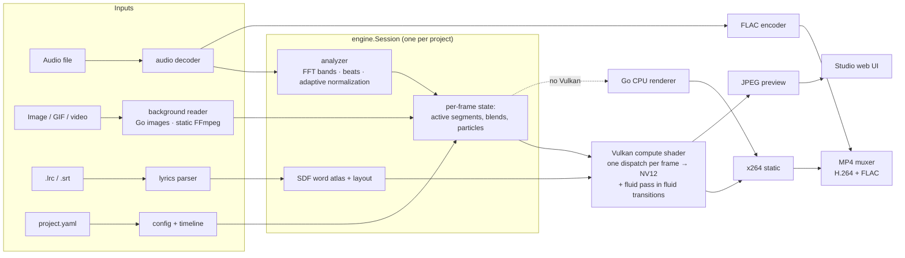

# AudioViz — technical documentation

How AudioViz works inside: architecture, algorithms, data formats and the reasons behind
each decision. The user-facing documentation (what each option does) is in [../index.md](../index.md);
these pages are for whoever maintains, extends or ports the code.

| Page | Covers |
|---|---|
| [audio-analysis.md](audio-analysis.md) | Audio decoding, FFT bands, beats, adaptive normalization, FLAC encoder |
| [rendering.md](rendering.md) | Frame pipeline, Vulkan compute shader, CPU fallback, effects, visualizers, particles, render session |
| [lyrics-rendering.md](lyrics-rendering.md) | `.srt`/`.lrc` parsing, word timing, SDF text atlas, layout, animations |
| [lyrics-generation.md](lyrics-generation.md) | Synced lyrics from audio + text: Demucs, Whisper, alignment, Resync, evaluation |
| [image-generation.md](image-generation.md) | Images from a prompt and reference images: stable-diffusion.cpp on the shared ggml, models, binding, studio API |
| [media-io.md](media-io.md) | Background images/videos (static FFmpeg), x264 encoder, MP4 muxer |
| [config-and-timeline.md](config-and-timeline.md) | YAML project model, segments over time, cut/fade transitions |
| [studio.md](studio.md) | Studio server and HTTP API, web app architecture, performance design, lyrics editing |
| [build.md](build.md) | Static build: x264, FFmpeg, whisper.cpp, demucs.cpp, Go flags, runtime Vulkan loading |
| [portability.md](portability.md) | What ties the code to Linux and what porting to Windows / macOS needs |
| [known-issues.md](known-issues.md) | Bugs, limits, CPU/GPU differences and dead code found while documenting |

`planning/` holds the **original design** (CPU workers piping raw frames to an `ffmpeg`
process). It is kept for history only: the current architecture below replaced it.

## Goals that shaped everything

1. **One file, nothing to install.** The binary depends only on libc/libm. Every library
   (x264, a decode-only FFmpeg, whisper.cpp/ggml, demucs.cpp, libstdc++) is linked statically,
   the web studio is embedded, and the Vulkan loader is opened at runtime only if it exists.
2. **GPU from any vendor.** Rendering and speech recognition use Vulkan (no CUDA/Metal-only
   code), with an automatic CPU fallback when there is no Vulkan driver.
3. **Reactive but readable.** Every effect reacts to a chosen band (`react_to`) whose level is
   normalized to its *local* range, so quiet and loud parts of a song both move.
4. **Edit visually, render reproducibly.** The studio edits the same `project.yaml` the CLI
   renders; the preview uses the same renderer as the export.

## Architecture

**Export** (`audioviz project.yaml` or *Export* in the studio): the session renders every
frame on the GPU straight into NV12, which x264 encodes; the audio is re-encoded losslessly to
FLAC and both are muxed into an MP4 by our own muxer. No temporary files, no external process.

**Studio preview**: the same session renders single frames at a reduced resolution (preview
scale), encoded as JPEG and requested by the browser a few frames ahead while playing. Export
runs on a *fork* of the session so editing can continue meanwhile.

**Lyrics generation** is a separate pipeline (`internal/lyricsgen`) that produces a word-timed
`.lrc`; the renderer only consumes `.lrc`/`.srt` files.

## Package map

| Package | Role |
|---|---|
| `cmd/audioviz` | CLI: render, preview, still frame, `--init`, `--list-gpus`; subcommands `studio` and `lyrics` |
| `internal/config` | YAML model, defaults/template, timeline segments, blend/lerp for fades |
| `internal/audio` | Decoding, analysis (bands, beats, normalization), FLAC encoder |
| `internal/engine` | `Session` (per-project render state, seek, fork) and the export loop |
| `internal/gpu` | Vulkan device/pipeline in C (`vk.c`), Go wrapper, `shaders/render.comp` |
| `internal/effects`, `internal/visualizer`, `internal/particles` | Effect/visualizer/particle logic (CPU path and parameters for the GPU) |
| `internal/lyrics` | Lyric parsing, SDF atlas, layout, animation and style |
| `internal/lyricsgen` | Demucs separation, Whisper recognition, alignment, Resync, model download |
| `internal/video` | Background readers (pure Go images, static FFmpeg for videos) |
| `internal/encode` | x264 (cgo) |
| `internal/mux` | MP4 writer |
| `internal/studio` | HTTP server, jobs, SSE, and the embedded web app (`web/`) |

## Decision log

| Decision | Why | Instead of |
|---|---|---|
| Vulkan compute, single dispatch per frame, NV12 output | Vendor-agnostic GPU; writing NV12 on the GPU avoids a CPU colour conversion and a large readback | CPU workers + RGBA frames piped to `ffmpeg` (original design) |
| `dlopen` libvulkan at runtime (renderer and a small shim for ggml) | The binary must start on machines without a Vulkan driver and fall back to CPU | Linking libvulkan |
| x264 + own MP4/FLAC writers, decode-only static FFmpeg | No external binaries; lossless audio in the MP4 | Shelling out to `ffmpeg` |
| Adaptive normalization per band | Quiet intros and loud choruses both react visibly | Global normalization |
| SDF word atlas sampled on the GPU | Sharp text at any scale, glow/outline/fire colours cheaply, per-word animation | Rasterizing text per frame on the CPU |
| Lyrics generation inside the binary (whisper.cpp + demucs.cpp, static) | Nothing to install; GPU recognition via the same Vulkan path | A Python tool (Demucs + stable-ts) used at first, removed |
| Needleman-Wunsch alignment of known lyrics to recognized words | The text is known; only timing is needed, and recognition errors are absorbed | Using Whisper's transcription as the lyrics |
| Web studio with Preact + htm, vendored, no build step | Embeddable as static files, editable without a JS toolchain | A native GUI toolkit |
| Playback time in a tiny store, components subscribe selectively | Re-rendering the whole UI at 60 fps made open dropdowns flicker | Time in top-level React state |
| English code/UI with an optional Spanish dictionary | One language in the code base, UI selectable | Mixed Spanish/English |

## Runtime files

| What | Where |
|---|---|
| Models (Whisper large-v3-turbo q5_0, htdemucs 4s f16) | `<user cache>/audioviz/models` (`~/.cache/audioviz` on Linux), override with `AUDIOVIZ_CACHE` |
| Separated vocals cache (16 kHz mono float32) | `<user cache>/audioviz/vocals/<sha1>.f32` |
| Project | `project.yaml` + referenced files; uploads from the studio go to `assets/` next to it |
| Generated lyrics | `lyrics.lrc` next to the project by default (any path set in the project is kept) |

## Environment variables

| Variable | Effect |
|---|---|
| `AUDIOVIZ_CACHE` | Cache directory for models and separated vocals |
| `AUDIOVIZ_NO_VULKAN=1` | Lyrics recognition behaves as if there were no Vulkan (CPU), for testing |
| `AUDIOVIZ_DEBUG_REC=<file>` | Dump the words Whisper recognized (generation) / windows and words per Resync group |

## History

| Date | Milestone |
|---|---|
| 2026-09-26 | Original version (CPU + `ffmpeg` process) |
| 2026-09-26 | v2: Vulkan GPU renderer, no ffmpeg (static x264, FLAC/MP4 in Go), adaptive normalization; gradients along bars, `react_to` per effect, shake, particle layers per band, docs; `center_gap`; synced lyrics (SDF on the GPU, karaoke, positions, animations) |
| 2026-10-02 | Timeline with segments and cut/fade transitions, reusable render session; video backgrounds via static decode-only FFmpeg; AudioViz Studio |
| 2026-10-03 | Studio design system and onboarding; lyrics generation built into the binary (whisper.cpp + demucs.cpp); translation to English with selectable UI language; lyric editing on the timeline (drag lines/words, Resync, Edit words mode); zoom anchoring; audio scrubbing; Resync and line-end accuracy fixes |
