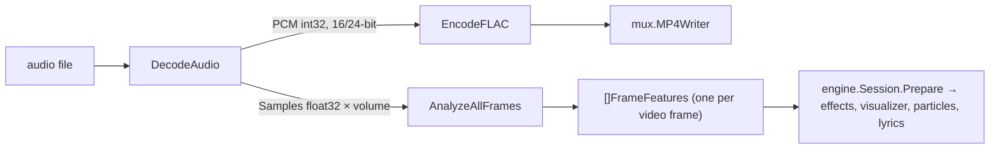

# Audio: decoding, analysis and FLAC encoding

Package `internal/audio`. It turns an audio file into:

1. a **decoded track** (`DecodedAudio`) kept in memory for the whole session,
2. one **feature record per video frame** (`[]FrameFeatures`) that every effect, visualizer,
   particle layer and lyric style reads,
3. at export time, a **lossless FLAC stream** (`FLACStream`) that the MP4 muxer stores as the
   video's audio track.

The user-facing view (formats, `volume`, `sensitivity`, `react_to`, normalization options) is in
[../audio.md](../audio.md) and [../reactivity.md](../reactivity.md). This page explains how it works.

| File | Contents |
|---|---|
| `internal/audio/decoder.go` | `DecodeAudio`, per-format decoders, `DecodedAudio`, `ExtractChannelSamples`, `ComputeRMS` |
| `internal/audio/analyzer.go` | `AudioAnalyzer`, `FrameFeatures`, FFT, band energies, normalization, smoothing, beats |
| `internal/audio/bands.go` | `FrameFeatures.Band`: maps a `react_to` name (and its aliases) to a value |
| `internal/audio/flacenc.go` | Pure-Go FLAC encoder (`EncodeFLAC`) |
| `internal/audio/analyzer_test.go`, `norm_test.go` | Tests (see [Tests](#tests)) |



## 1. Decoding (`decoder.go`)

Everything is **pure Go** (no cgo, no FFmpeg — the static FFmpeg in `internal/video` is only
for background videos).

| Format | Detection in `DecodeAudio` | Decoder | Output bit depth |
|---|---|---|---|
| FLAC | magic `fLaC` | `github.com/mewkiz/flac` (`decodeFLAC`) | source depth, normalized to 16 or 24 |
| WAV | `RIFF....WAVE` | own chunk parser (`decodeWAV`, `wavSamples`) | 16 (≤16-bit input) or 24 (>16-bit input) |
| OGG Vorbis | magic `OggS` | `github.com/jfreymuth/oggvorbis` (`decodeOGG`) | 16 (float → int) |
| MP3 | extension `.mp3`, or `ID3` tag, or MPEG frame sync (`0xFF Ex`) | `github.com/hajimehoshi/go-mp3` (`decodeMP3`) | 16 (go-mp3 always outputs 16-bit stereo) |

Detection is by **magic bytes first** (first 12 bytes); the extension only matters for MP3.
Anything else returns `unsupported audio format`.

WAV details (`wavSamples`): PCM 8/16/24/32-bit and IEEE float 32/64-bit;
`WAVE_FORMAT_EXTENSIBLE` (0xFFFE) is resolved to its sub-format; unknown chunks are skipped
(with the RIFF pad byte); a `data` size of 0 or 0xFFFFFFFF (streamed WAV) means "read to the end".
32-bit integer PCM is shifted down to 24 bits; floats are converted to 24-bit integers
(`floatToInt`, rounded and clamped); 8-bit unsigned is centered and shifted to 16 bits.

### PCM representation: `DecodedAudio`

The file is decoded **entirely into memory** at its **native sample rate** (no resampling) and
always as **stereo**:

| Field | Type | Meaning |
|---|---|---|
| `SampleRate` | int | Native rate of the file |
| `Channels` | int | Always 2 |
| `PCM` | `[]int32` | Interleaved `L0 R0 L1 R1 …`, integer, **without** the volume applied. Used for the FLAC output (and by `audioviz lyrics`) |
| `BitsPerSample` | int | 16 or 24 (the two depths the FLAC encoder writes) — see `normalizeDepth` |
| `Samples` | `[]float32` | Same samples as floats in [-1, 1], **multiplied by `audio.volume`** and clamped. Used only for analysis |
| `DurationSec` | float64 | `len(PCM)/2 / SampleRate` |

Why two copies: the analysis wants floats with the user's analysis gain (`volume`), but the
output audio must be bit-exact, so the integer PCM is kept untouched. Cost: 16 bytes per stereo
sample frame, about 185 MB for a 4-minute 48 kHz song.

Channel handling (`toStereo`): mono is duplicated to L and R; stereo is kept; **more than two
channels** are downmixed by averaging *even-index* channels into L and *odd-index* channels into R.
This is a naive downmix: with the usual 5.1 order (FL FR FC LFE BL BR) the LFE ends up in R only
and the center only in L.

`normalizeDepth`: depths below 16 are shifted up to 16, 17–23 up to 24, above 24 down to 24.

Helpers used by the analyzer: `ExtractChannelSamples(ch, center, size, dst)` copies a window
**centered** on a sample index, zero-filling outside the track; `ComputeRMS` is a plain RMS.

## 2. Analysis (`analyzer.go`)

### One analysis frame per video frame

There is no separate audio frame rate: `AnalyzeAllFrames(totalVideoFrames)` produces exactly one
`FrameFeatures` per **video** frame. Frame `i` is analysed around sample
`int(i * SampleRate / fps)`.

| Parameter | Value | Where |
|---|---|---|
| FFT size / window length | `FFTWindowSize = 2048` samples (42.7 ms at 48 kHz, 23.4 Hz per bin) | `analyzer.go` const |
| Window function | Hann, `0.5·(1 − cos(2πi/(N−1)))` | `NewAudioAnalyzer` |
| Hop | `SampleRate / fps` samples (800 at 48 kHz / 60 fps; 1600 at 30 fps) | `AnalyzeAllFrames` |
| Window position | centered on the frame's start sample (`[c−1024, c+1024)`), zero padded at the ends | `ExtractChannelSamples` |
| FFT | own iterative radix-2 complex FFT with precomputed bit-reversal and twiddle tables (`fftPlan`), real input in `re`, `im = 0` | `newFFTPlan`, `transform` |
| Spectrum | magnitude `hypot(re, im)` of bins `0 … N/2−1`, separately for L and R; not scaled by N | worker loop |

The total frame count comes from the session: `Frames = int(DurationSec * fps)`
(`engine.Session.Update`). The **analysis depends on fps**: changing `output.fps` invalidates the
cache and re-analyses.

**Parallelism**: the per-frame FFT work has no inter-frame state, so `runtime.NumCPU()` workers
pull frame indices from an atomic counter (each with its own buffers; the `fftPlan` is shared
read-only). Normalization, smoothing and beat detection are temporal and run afterwards, in
order, on a single goroutine (except `normalizeBars`, which runs one goroutine per bar).

### Raw values per frame

For every frame the workers store a `rawFrame`:

| Value | Formula | Notes |
|---|---|---|
| `barsL`, `barsR` (`barCount` each) | for bar *i*: mean magnitude of its bins, then `log10(1 + 9·avg) / 1.5` | `extractBars` |
| `bass` | mean of `(magL+magR)/2` over 20–150 Hz bins, then `log10(1 + 8·avg)` | `calculateBandEnergy` |
| `mid` | same over 150–3000 Hz | |
| `treble` | same over 3000–16000 Hz | |
| `rmsAll` | `(RMS(L window) + RMS(R window)) / 2` on the un-windowed samples | `ComputeRMS` |

Bar frequency ranges are precomputed in `NewAudioAnalyzer`: `barCount` bands **logarithmically
spaced from 25 Hz to 18 kHz** (`f_i = 25 · (18000/25)^(i/barCount)`), converted to bins with
`floor(fStart/hzPerBin)` … `ceil(fEnd/hzPerBin)`, at least one bin, bin ≥ 1 (DC skipped), capped at
`N/2`. Consequence: at 2048 points the lowest bars are narrower than one bin, so **several
adjacent low bars read the same bin(s)** and look identical. If the sample rate is low enough
that 18 kHz is above Nyquist, the top bars end up empty (0).

The band-energy ranges use `int(f/hzPerBin)` (truncation) instead, and are fixed: they do not
depend on `barCount`.

### Band names and aliases (`bands.go`)

`FrameFeatures.Band(name, def)` is the single place where a `react_to` string becomes a number.
An empty name uses `def` (each effect passes its own default).

| Name(s) | Returns |
|---|---|
| `bass` (and **any unknown name**) | `BassEnergy` |
| `mid`, `mids`, `medios` | `MidEnergy` |
| `treble`, `high`, `highs`, `agudos` | `TrebleEnergy` |
| `overall`, `rms`, `volume` | `OverallRMS` |
| `transient`, `flux` | `min(SpectralFlux × 5, 1.5)` |
| `beat`, `kick` | `BeatPulse` |

`medios` and `agudos` are the Spanish names used by projects written before the code base was
translated to English; they are kept so old YAML files still work. Unknown names silently fall
back to bass (no error).

### Adaptive normalization

Enabled by `AudioAnalyzer.Normalize` (default `true`, from `audio.normalize`) with
`WindowSec` (default 4.0, from `audio.normalize_window`). The goal: every signal uses its whole
0–1 range *locally*, so a constantly loud bass still "breathes" and a song with little treble still
moves treble effects. Done once, over the whole song, before smoothing.

```
win = int(WindowSec * fps)          // frames on EACH side (±4 s → 240 frames at 60 fps)
bass, mid, treble, rmsAll: normalizeSeries(win, series)   // each signal on its own
bars:                      normalizeBars(win, barsL, barsR)
```

**`rollingRange(x, win)`** computes, for every frame `t`, the local floor and ceiling of `x` over
`[t−win, t+win]` (clipped to the track):

- floor `lo` = 10th percentile, ceiling `hi` = 97th percentile (sort the window, take index
  `int((len−1)·0.10)` and `int((len−1)·0.97)`).
- To keep it cheap it is **evaluated only on a grid** every `step = win/12` frames (20 frames at
  60 fps / 4 s; at least 1), plus the last frame, and **linearly interpolated** in between.
  Cost is roughly `(n/step) · (2·win) · log(2·win)` per signal instead of `n` sorts.

**`normalizeSeries`** (energies):

```
minSpan = max(0.25 · max_t hi[t], 1e-4)     // global: avoids amplifying near-silence
x'[t]   = softKnee( (x[t] − lo[t]) / max(hi[t] − lo[t], minSpan) )
```

**`normalizeBars`** (spectrum bars):

- one range per bar, computed on `max(L, R)` and **shared by L and R** so the stereo balance is
  preserved;
- the minimum span is **per frame and relative to the whole spectrum**:
  `minSpan[t] = max(0.35 · max_b hi_b[t], 1e-4)`, so a nearly empty band is not inflated to
  full height just because its own range is tiny.

**`softKnee(v)`**: `0` below 0; linear up to 0.85; above that
`0.85 + 0.15 · tanh((v − 0.85)/0.15)`, which approaches 1.0 asymptotically. Peaks above the
97th percentile are compressed instead of clipped.

With `Normalize = false` (or a single frame) the raw values are only clamped:
`min(x, 1)` for bass/mid/treble and every bar (`rmsAll` is not clamped; it cannot exceed 1 anyway
because `Samples` is clamped).

[../reactivity.md](../reactivity.md#adaptive-normalization) quotes the effect on the example song
(bars saturated 43.8 % of the time without normalization, 0.9 % with it); that number comes from
`TestNormalizationStats`.

### Smoothing of the bars (ballistics)

Applied sequentially, **only to the bars** (energies are not smoothed), after normalization.
Per bar and channel, with `s = visualizer.smoothing` (default 0.75) and
`d = visualizer.decay_rate` (default 0.12):

```
v = raw · sensitivity                 // audio.sensitivity: only scales the bars
if v >= prev:  out = prev·(1−s) + v·s  // attack: fast (75 % of the way per frame by default)
else:          out = max(0, prev·(1−d)) // release: geometric fall towards 0, ignoring v
```

Notes for maintainers:

- The parameter called `smoothing` is really the **attack weight**: a higher value makes bars
  *faster*, not smoother. The YAML comment (`0.0 hard reactive … 0.95 very smooth`) describes
  the opposite.
- On release the bar decays toward 0, not toward `v`; it falls at least to `v` and then
  re-attacks the next frame. It behaves like a peak meter.
- Both constants are per frame, so the visual speed depends on fps.
- With `sensitivity > 1` bars can exceed 1; renderers map them to `min_height … max_height`
  without clamping.
- `NewAudioAnalyzer` replaces non-positive `smoothing`, `decayRate`, `barCount`, `sensitivity`
  with 0.75, 0.12, 48, 1.0.

### Beat / transient detection

Also sequential, per frame, on the (normalized) `bass` value:

```
flux     = max(0, bass[t] − bass[t−1])          // bass[−1] = 0
thresh   = 0.15 if Normalize else 0.08
isBeat   = flux > thresh && flux > 1.2 · flux[t−1]
pulse    = 1.0 if isBeat else pulse · 0.82       // per frame
```

`SpectralFlux` in `FrameFeatures` is this **positive bass-energy difference**, not a full
spectral flux. `BeatPulse` decays by ×0.82 per frame (about 5 % left after 15 frames); like the
bar ballistics, this is frame-based, so the pulse lasts twice as long in seconds at 30 fps as at
60 fps, and the per-frame `flux` threshold is easier to exceed at lower fps.

### Output: `FrameFeatures`

There is no `Analysis` struct: the analysis is a plain slice `[]audio.FrameFeatures`, indexed by
video frame.

| Field | Range | Meaning |
|---|---|---|
| `FrameIndex`, `TimestampSec` | — | `i`, `i / fps` |
| `LeftBars`, `RightBars` | `[]float64`, `barCount` each, ~0–1 (more with `sensitivity > 1`) | Smoothed spectrum bars per channel |
| `BassEnergy`, `MidEnergy`, `TrebleEnergy` | 0–1 | Band energies (normalized or clamped), not smoothed |
| `OverallRMS` | 0–1 | Volume |
| `SpectralFlux` | ≥ 0 | Positive bass delta (see above) |
| `IsBeat` | bool | Beat detected on this frame |
| `BeatPulse` | 0–1 | 1 on a beat, decaying |

Note: [../reactivity.md](../reactivity.md) says every source ranges 0–1; `transient` actually
returns up to 1.5 (`SpectralFlux × 5`, clamped at 1.5).

### How the session consumes it (`internal/engine/session.go`)

- `AudioAnalyzer` is **stateful and single-use**: `prev*` and `beatPulseVal` persist inside the
  instance, so each analysis creates a new analyzer and calls `AnalyzeAllFrames` once.
- `Session.featuresLocked(anaKey)` caches analyses by
  `anaKey{bars, smoothing, decay, sens, normalize, window}`. The **base analysis** uses the
  first visualizer segment's bar settings; its energies/beats feed the background effects,
  particles and lyrics (`FrameState.Feat`). A visualizer segment with a different `bars` /
  `smoothing` / `decay_rate` gets its own analysis (`FrameState.VizFeat`), computed lazily the
  first time a frame needs it. Energies and beats are identical across keys — only bars differ.
- The cache is dropped when the audio path/volume or the fps changes (`Session.Update`).
- Without audio, `featuresLocked` returns an all-zero slice of `30 s · fps` frames
  (`silentDuration`) so the studio can still preview.
- Consumers read the record of the current frame index: `feat.Band(react_to, default)` in
  `effectsAt`, `particles.ParticleSystem.Update`, `lyrics` (`StyleFor`, `Engine.Frame`), and the
  bars in `visualizer/*` (CPU) or `fillParams` → `gpu.Params.Bars` (GPU). See
  [rendering.md](rendering.md).

## 3. FLAC encoder (`flacenc.go`)

Why: the output MP4 carries the original audio losslessly without FFmpeg. A FLAC encoder that
only needs fixed predictors fits in ~450 lines of Go.

`EncodeFLAC(pcm []int32, sampleRate, bps, maxSamples int) *FLACStream` — interleaved stereo,
`bps` 16 or 24, `maxSamples > 0` truncates (callers pass 0). `ExportRange`
(`internal/engine/render.go`) slices `DecodedAudio.PCM` to exactly the exported frame range and
encodes it in a goroutine while the video renders.

| Aspect | Implementation |
|---|---|
| Block size | Fixed `FLACBlockSize = 4096` samples (last block shorter); fixed-blocksize stream, frame number coded in UTF-8 style |
| Parallelism | Frames are independent: `NumCPU` workers, one `frameEncoder` each |
| Stereo decorrelation | Computes L, R, M=(L+R)>>1, S=L−R; estimates each channel's cost and picks the cheapest of independent (0001), left/side (1000), right/side (1001), mid/side (1010). The side channel is coded with `bps+1` bits |
| Prediction | `FIXED` predictors only, order 0–4, chosen by minimum Σ\|residual\| (`bestFixedOrder`). No LPC, no wasted-bits, no VERBATIM fallback |
| Constant blocks | Detected and written as `CONSTANT` subframes (digital silence) |
| Residual coding | Partitioned Rice, partition order 0–8 (must divide the block, partition longer than the predictor order), parameter searched at `⌊log2(mean)⌋ ± 1` (`bestRice`); switches to `RICE2` (5-bit parameters) if any parameter > 14 |
| Frame header | sync `0xFFF8`, block-size code 7 (16-bit `n−1` at the end), sample-rate code from a table (88.2/176.4/192/8/16/22.05/24/32/44.1/48/96 kHz; other rates use code 0 = "see STREAMINFO"), channel assignment, sample-size code 4 (16 bit) or 6 (24 bit), CRC-8 |
| Frame footer | CRC-16 (poly 0x8005) |
| STREAMINFO | min/max block size 4096, min/max frame size, rate, 2 channels, bps, total samples, MD5 of the interleaved little-endian PCM |

`FLACStream` keeps the frames **separate** (`Frames [][]byte`, `FrameSamples []int`) because the
MP4 muxer stores one FLAC frame per MP4 sample; `StreamInfo` (34 bytes) goes into the `dfLa`
box (see [media-io.md](media-io.md#flac-audio-track)). `FileBytes()` concatenates them into a
native `.flac` file (`fLaC` + one STREAMINFO block + frames) for testing.

Compression is a bit worse than reference `flac -5` (no LPC) but the output is lossless. A
round trip (encode → `FileBytes` → `DecodeAudio`) at 16/24 bit and 11.025/44.1/48 kHz
reproduces the PCM exactly; this was checked by hand, there is **no test for it in the repo**.

## Tests

| Test | What it checks |
|---|---|
| `TestDecodeAndAnalyze` (`analyzer_test.go`) | Decodes `I didnt ask to be the devil.flac` from the repo root; expects 48 kHz and > 10 s; analyses 60 frames at 60 fps with 48 bars and checks 60 records with 48 L/R bars each. Logs a few values |
| `TestNormalizationStats` (`norm_test.go`) | Analyses the same song at 60 fps / 56 bars with `Normalize` false and true and **logs** the share of bars > 0.95 and the bass mean/stddev/range. It asserts nothing; it is a measurement tool |

Both depend on a song that is **not in the repository**. Without it, `TestNormalizationStats`
skips but `TestDecodeAndAnalyze` **fails** (`t.Fatalf`). Nothing tests the FLAC encoder, WAV/MP3/OGG
decoding, `Band` aliases or the normalization math directly.
