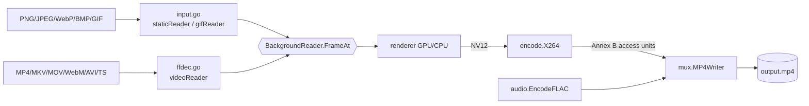
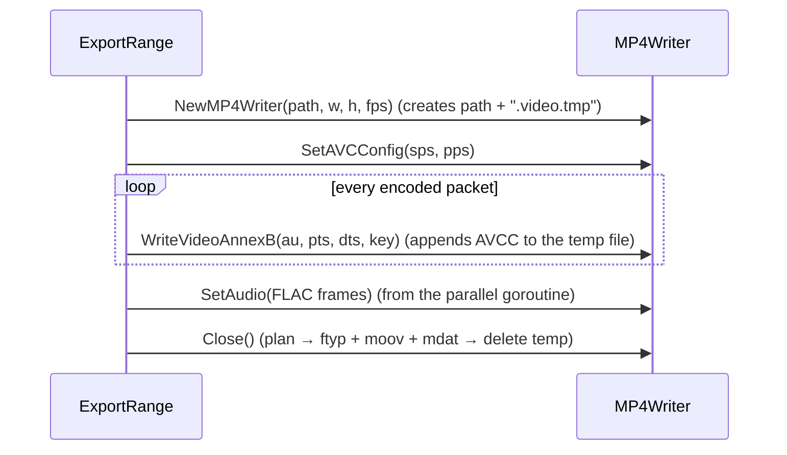

# Media I/O: backgrounds, H.264 encoding, MP4 muxing

Everything that reads or writes media other than the input audio:

| Package / file | Role | Language |
|---|---|---|
| `internal/video/input.go` | `BackgroundReader` interface, images and GIFs, fit modes, `ProbeMedia` | pure Go |
| `internal/video/ffdec.go` | Background **video** decoding with a minimal, statically linked FFmpeg | cgo (C in the preamble) |
| `internal/encode/x264.go` | H.264 encoder: statically linked libx264 | cgo |
| `internal/mux/mp4.go` | Own MP4 (ISO BMFF) writer: H.264 + FLAC | pure Go |

Input audio decoding and the FLAC encoder are in [audio-analysis.md](audio-analysis.md). User
options are in [../background/README.md](../background/README.md) and [../output.md](../output.md).
How the static libraries are built: [build.md](build.md).



**Dead code:** the original version's `internal/video/output.go` (`NewVideoWriter`,
`DetectBestCodec`), which piped raw frames to an external `ffmpeg` process, is no longer used by
anything (no reference to its functions anywhere). It is still in the repository, pending
deletion.

## 1. Backgrounds (`internal/video`)

### `BackgroundReader`

```go
type BackgroundReader interface {
    Width() int
    Height() int
    FrameAt(t float64) (*image.RGBA, int) // t = seconds since the segment started
    Close() error
}
```

- Readers are created **already scaled to the output resolution** (`NewBackgroundReader(path, w,
  h, fitMode, loop)`), so `FrameAt` returns an `*image.RGBA` of exactly `w×h`, opaque.
- The `int` is a **version**: it changes only when the returned image changes. The session turns
  it into `"%p:%d"` (reader pointer + version) and the GPU renderer skips re-uploading the
  background when it is unchanged (`Renderer.submit` in `internal/engine/render.go`). A still
  image always returns version 0.
- The returned image may be **reused** by the reader (the video reader returns the same canvas
  every time); callers must copy it before the next `FrameAt`.
- Readers are not thread-safe; `engine.Session` serializes access with its mutex and caches
  readers by `path|fit_mode|loop_video` (`Session.mediaFor`). All readers are closed and rebuilt
  when the output resolution changes.
- The time passed is `t − segment.At`: a background starts from its beginning when its timeline
  segment starts (`Session.Prepare`). During a background crossfade both readers are queried.

Dispatch (`NewBackgroundReader`): extension in `videoExts` (`.mp4 .mkv .mov .webm .avi .m4v
.ts`, case-insensitive) → video reader; otherwise the file is sniffed with `image.DecodeConfig`:
an animated GIF (more than one frame) → `gifReader`, anything else → `staticReader`.

### Images and GIFs (`input.go`, pure Go)

Registered decoders: PNG, JPEG, GIF (standard library), BMP and WebP (`golang.org/x/image`).

`fit(src, w, h, mode)` produces the scaled frame:

| `fit_mode` | Scale | Result |
|---|---|---|
| `cover` (default; also any unknown value) | `max(w/srcW, h/srcH)` | fills the frame, centered, overflow cropped |
| `contain` | `min(w/srcW, h/srcH)` | whole image visible, centered, black bars |
| `stretch` | independent X/Y | fills exactly, aspect ratio not kept |

The canvas is first filled with opaque black; the image is scaled with **Catmull-Rom**
(`xdraw.CatmullRom.Scale`) and composited with `Over`, so transparent areas become black.

`gifReader` (`newGIFReader`):

- All frames are **composed and pre-scaled at load time** (memory: frames × w × h × 4 bytes —
  a 100-frame GIF at 1080×1920 is ~830 MB).
- Composition follows GIF disposal: each frame is drawn `Over` the running canvas;
  `DisposalBackground` clears the frame rectangle to transparent (black after `fit`),
  `DisposalPrevious` restores the canvas from before the frame.
- Frame delays: `Delay[i]/100` s; a delay of 0 or 1 (1/100 s) is treated as **0.1 s**, like
  browsers do.
- `FrameAt` finds the frame whose cumulative end time is past `t`; with `loop` the time wraps
  modulo the total duration, without it the last frame is held. The frame index is the version.

`ProbeMedia(path)` returns `{IsAnimated, IsVideo, Width, Height, Duration}` with dimensions
**rounded down to even** (H.264/NV12 need even sizes). It is used for automatic output resolution
(`output.width/height = 0` → size of the first background, `Session.Update`) and by the studio
(`/api/probe`, file browser).

### Videos (`ffdec.go`, static FFmpeg)

Background videos are the **only** use of FFmpeg in the program. It is a decode-only build linked
statically from `third_party/build/lib` (`libavformat.a libavcodec.a libswscale.a libavutil.a`),
configured by `scripts/build-ffmpeg.sh` (branch `release/7.1`) with `--disable-everything` plus:

| Kind | Enabled |
|---|---|
| Protocols | `file` only (no network) |
| Demuxers | `mov` (mp4/mov/m4v), `matroska` (mkv/webm), `avi`, `mpegts`, `m4v`, `h264`, `hevc` |
| Decoders | `h264`, `hevc`, `vp8`, `vp9`, `mpeg4`, `mjpeg`, `prores`, `png`, `mpeg2video` |
| Other | `swscale`; no avfilter, avdevice, swresample, no audio decoders |

**Not supported**: AV1 (common in `.webm`/`.mp4` from the web) and anything else outside the
list; such files fail at open with "the file has no supported video stream". The audio streams of
background videos are ignored.

The C side is a small state machine in the cgo preamble (`vdec` struct):

| C function | What it does |
|---|---|
| `vd_open` | `avformat_open_input` + `avformat_find_stream_info`; `av_find_best_stream(VIDEO)`; opens the decoder with `thread_count = 0` (FFmpeg picks); stores time base, duration (container duration, else stream duration) and fps (`av_guess_frame_rate`, default 30) |
| `vd_next` | Standard send/receive loop: `avcodec_receive_frame`; on `EAGAIN` reads the next packet of the video stream; at end of file sends a flush packet and drains. Frame time: `best_effort_timestamp`, else `pts`, else previous + 1/fps |
| `vd_seek` | `av_seek_frame(stream, t, AVSEEK_FLAG_BACKWARD)` (to the keyframe before `t`), falling back to a container-level seek; flushes the decoder |
| `vd_scale` | `sws_scale` with `SWS_BICUBIC` from the decoded pixel format to RGBA at the scaled size; the `SwsContext` is rebuilt only if source size/format or target size change |
| `vd_close` | Frees everything |

Go side, `videoReader`:

- `newVideoReader` computes the scaled size (`dw×dh`) and offset (`ox, oy`) for the fit mode with
  the same rules as `fit` (minimum 2×2), and allocates the scaled buffer with `C.malloc` so C can
  write into it.
- `FrameAt(t)`:
  1. With `loop` and a known duration, `t = t mod duration`.
  2. **Seek** only if there is no frame yet, if `t` is earlier than the current frame by more than
     half a frame, or if it is more than **2 s** ahead. Otherwise it **decodes forward**, which is
     cheaper for sequential export and for playback in the studio.
  3. Decodes until the current frame time + half a frame ≥ `t`. At end of file with `loop` it
     seeks to 0 and continues (stops if the time wrapped); without `loop` it keeps the last frame.
  4. If a new frame was decoded, `blit` scales it and copies the visible rectangle into the opaque
     black canvas (cropping for `cover`, letterboxing for `contain`) and increments the version.
- The decoder works at the video's own frame rate; with a different output fps, frames are
  repeated or skipped (nearest-earlier frame). No frame interpolation.

## 2. H.264 encoding (`internal/encode/x264.go`)

libx264 from the `stable` branch, built by `scripts/build-x264.sh` as a static 8-bit, 4:2:0-only
library (`--bit-depth=8 --chroma-format=420`, no CLI, no OpenCL, no lavf/swscale).

`NewX264(width, height, fps, preset, crf)` → `enc_open` in the cgo preamble:

| Setting | Value | Why |
|---|---|---|
| Preset | `x264_param_default_preset(preset, tune = NULL)`; `output.preset`, default `fast` | User-selectable speed/size trade-off |
| Profile | `high` (`x264_param_apply_profile`) | Universal playback |
| Rate control | CRF (`X264_RC_CRF`), `output.crf`, default 18 (`ExportRange` uses 18 when `crf ≤ 0`) | Constant quality |
| Input colorspace | `X264_CSP_NV12`, 2 planes, same stride for Y and UV | The GPU shader writes NV12 directly; no I420 path exists |
| Timebase / fps | `1/fps`, `fps/1`, `b_vfr_input = 0` | Constant frame rate; only integer fps |
| GOP | `i_keyint_max = 4 · fps` (a keyframe at least every 4 s); min keyint and scenecut from the preset | Seekability |
| B-frames, lookahead, refs | From the preset | — |
| Threads | `i_threads = 0` → x264 auto (frame threading on all cores) | Encoding is the bottleneck (the GPU takes 1–2 ms per frame) |
| Headers | `b_repeat_headers = 0`, `b_annexb = 1` | SPS/PPS are fetched once via `Headers()` and go into the MP4 `avcC`; packets are Annex B and the muxer converts them |
| Color signaling | VUI primaries/transfer/matrix = 1 (BT.709), `fullrange = 0` | Matches the conversion: both the shader (`render.comp`, `lumaOf`) and the CPU fallback (`rgbaToNV12` in `render.go`) use BT.709 limited range (Y 16–235, UV 16–240) |
| Log level | errors only | — |

Go API:

| Function | Notes |
|---|---|
| `Headers()` | SPS/PPS/SEI in Annex B. `ExportRange` keeps only NAL types 7 and 8 for `MP4Writer.SetAVCConfig` |
| `Encode(y, uv unsafe.Pointer, stride, pts)` | One NV12 frame. **The planes must be C memory** (mapped Vulkan buffers, or `encode.Alloc`); x264 copies the picture before returning. `pts` = frame index relative to the export start. Returns `nil` while x264 holds frames back (lookahead / B-frames) |
| `Flush(emit)` | Drains delayed frames with `x264_encoder_encode(NULL)` while `x264_encoder_delayed_frames > 0` |
| `Packet` | `Data` (one access unit, all NALs contiguous, Annex B), `PTS`, `DTS` (in frames; DTS can be negative with B-frames), `Key` |
| `Alloc` / `Free` | `C.malloc`/`C.free` for the CPU render path's NV12 buffers |

Strides: the GPU path passes `PadW` (width aligned to 16) as stride; the CPU path allocates
`stride = align(W, 16)` and height aligned to 16. x264 is given the real `width×height`.

## 3. MP4 muxer (`internal/mux/mp4.go`)

A minimal ISO BMFF writer: one H.264 track (`avc1`/`avcC`) and an optional FLAC track
(`fLaC`/`dfLa`, the "FLAC in ISOBMFF" mapping). Written in Go because no external tool may be
needed, and the format subset needed is small.

### Flow



`WriteVideoAnnexB` splits the access unit at start codes (`SplitAnnexB`, handles 3- and 4-byte
codes), drops SPS (7), PPS (8, kept only if none were set) and AUD (9), and writes every other NAL
with a 4-byte big-endian length prefix to the temp file. Only offsets, sizes, PTS/DTS and the
keyframe flag stay in memory. (The comment says SEI is dropped too; the code keeps SEI NALs.)

### File layout (faststart)

`Close` writes `ftyp`, then `moov`, then a single `mdat` — **`moov` first**, so the file plays
progressively in browsers without a rewrite pass. This works without knowing offsets up front
because all chunk offsets are written as **`co64`** (fixed 8 bytes): `moov` is built once with
offset 0 to measure its size, then rebuilt with the real `mdat` start. `mdat` always uses the
64-bit `largesize` header (16 bytes).

```
ftyp  major "isom", minor 512, compatible isom iso2 avc1 mp41
moov
  mvhd                timescale 1000, duration = max(video, audio) in ms, next_track_ID
  trak (video, ID 1)
    tkhd              flags 3 (enabled, in movie), width/height 16.16
    edts/elst         1 entry: media_time = first PTS (B-frame delay), rate 1.0
    mdia
      mdhd            timescale vts, language "und"
      hdlr "vide"
      minf  vmhd, dinf/dref("url " self-contained)
        stbl  stsd(avc1 + avcC), stts, [ctts], stss, stsc, stsz, co64
  trak (audio, ID 2)  only if audio frames were set
    tkhd              volume 1.0
    mdia
      mdhd            timescale = sample rate
      hdlr "soun"
      minf  smhd, dinf
        stbl  stsd(fLaC + dfLa), stts, stsc, stsz, co64
mdat (largesize)       interleaved chunks
```

### Video track details

- **Timescale** (`videoTimescale`): 90000 if it is a multiple of fps, else `fps × 1000`; every
  sample lasts `vtick = timescale / fps`, so `stts` has a single entry.
- **Timestamps**: x264 PTS/DTS are frame indices; `Close` shifts both so the first DTS is 0.
  `ctts` (version 0, unsigned offsets `(pts − dts)·vtick`, run-length coded) is written only if
  some offset is non-zero, i.e. when the preset uses B-frames. The edit list then skips the
  initial composition delay so presentation starts at time 0.
- **`stss`** lists keyframes (1-based). `stsc` is run-length coded from the per-chunk counts.
- **`avcC`**: version 1, profile/compat/level copied from SPS bytes 1–3, `lengthSizeMinusOne = 3`,
  one SPS, one PPS; for High profiles (profile_idc 100/110/122/144) the extension bytes are
  appended with chroma 4:2:0 and 8-bit luma/chroma.
- `avc1` sample entry: 72 dpi, depth 0x18, empty compressor name.

### FLAC audio track

- One MP4 sample = one FLAC frame (4096 samples, last one shorter); `stts` run-length coded in
  samples; `stsz` per frame.
- Sample entry `fLaC`: channel count, sample size = bits per sample, sample rate in 16.16 —
  **written as 0 when the rate exceeds 65535** (88.2/96/192 kHz); the real rate is in the `mdhd`
  timescale and in STREAMINFO.
- `dfLa` (full box v0): one metadata block header `0x80 00 00 22` (last block, STREAMINFO, 34
  bytes) followed by `FLACStream.StreamInfo`.
- No audio edit list: audio and video both start at 0. `ExportRange` slices the PCM from
  `start/fps` to `end/fps` seconds, so the audio lines up with the exported frame range.

### Interleaving

`Close` builds a **chunk plan with one chunk per second per track**: for second `s` a video
chunk with all samples whose DTS < `(s+1)·fps`, then an audio chunk with the FLAC frames up to
`(s+1)·sampleRate`. Chunks are written in that order, so audio and video are never more than
about a second apart in the file, which keeps progressive playback smooth. Video data is
streamed from the temp file; audio frames are already in memory.

### Limits and compatibility

- 32-bit (`version 0`) `mdhd`/`tkhd`/`mvhd` durations: about 13 h of video at the 90 kHz
  timescale; far beyond any song.
- Exactly one video codec (H.264) and one audio codec (FLAC); no `udta` metadata, no `btrt`.
- FLAC in MP4 plays in mpv, VLC, Chrome, Firefox, Android, ffmpeg and YouTube, but **not** in
  Apple QuickTime/Safari (see [../output.md](../output.md#compatibility)). Adding AAC would need an
  AAC encoder; that is the trade-off for lossless audio without dependencies.
- The temp file `<output>.video.tmp` sits next to the output and is deleted by `Close`. If
  export is cancelled before `Close` (context cancelled in `ExportRange`), the temp file is left
  behind.
