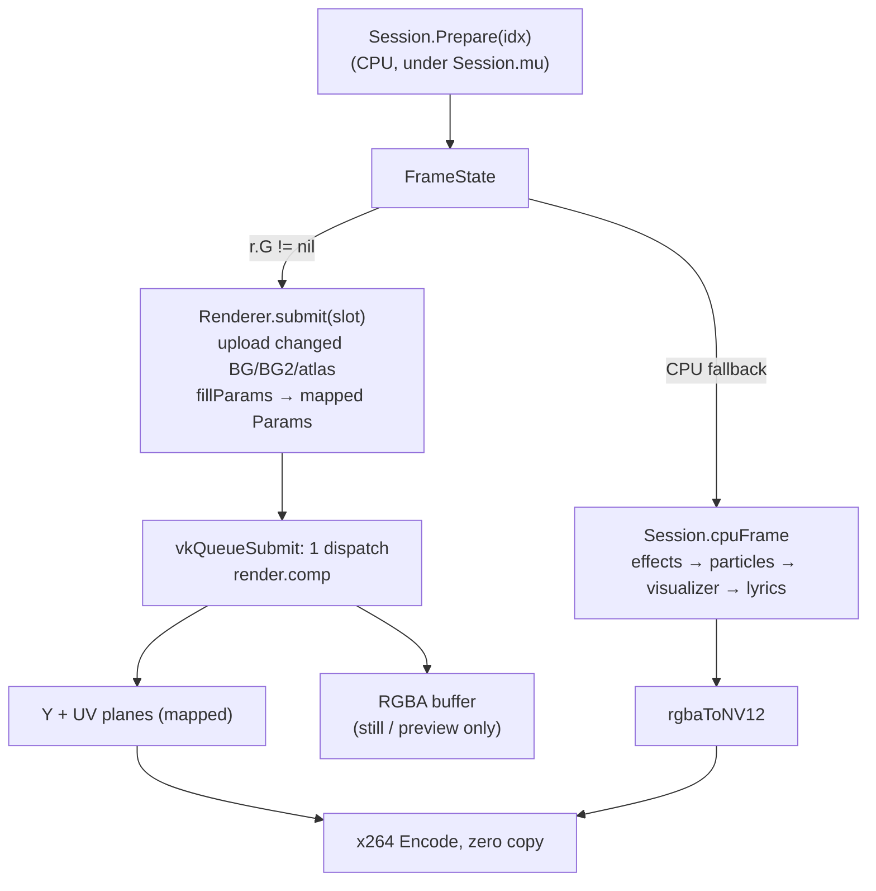
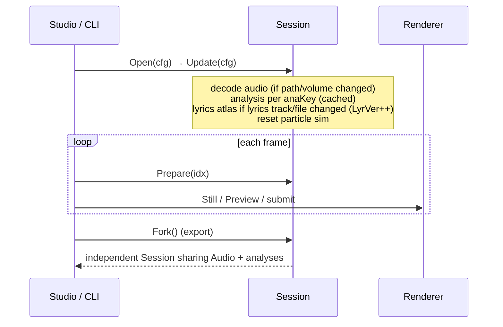

# Rendering

How a frame is produced: what the engine computes on the CPU, what it uploads to the GPU, what
the Vulkan compute shader does per pixel, and how the CPU fallback reproduces it. For what each
option means to a user see [../background/README.md](../background/README.md),
[../visualizer/README.md](../visualizer/README.md), [../particles/README.md](../particles/README.md)
and [../output.md](../output.md). Lyrics have their own page: [lyrics-rendering.md](lyrics-rendering.md).

| Where | What |
|---|---|
| `internal/engine/session.go` | `Session`: project state, `Prepare(idx)` → `FrameState`, background effects, particle simulation, `Fork` |
| `internal/engine/render.go` | `Renderer` (GPU or CPU backend), `ExportRange`, `Still`, `Preview`, `cpuFrame`, `fillParams`, `rgbaToNV12` |
| `internal/gpu/vk.c`, `vk.h` | Minimal Vulkan compute layer in C, libvulkan loaded with `dlopen` |
| `internal/gpu/gpu.go` | cgo wrapper, `Params` struct (mirror of the shader block), embedded SPIR-V |
| `internal/gpu/shaders/render.comp` | The whole frame in one compute dispatch |
| `internal/effects`, `internal/visualizer`, `internal/particles` | CPU implementations (gg / raw RGBA); particles are also the simulation for the GPU path |

## 1. Frame pipeline



`Prepare` is backend independent: it resolves the timeline at `t = idx / fps` and returns a
`FrameState` (`session.go`):

| Field | Content |
|---|---|
| `Feat` | Base analysis frame (bands, beat) — drives effects, particles, lyrics, ring pulse |
| `FX` (`frameFX`) | Resolved background effect values: zoom, shake dx/dy, ripple amp/freq/time, chroma shift/mode, glitch on/off, brightness, contrast |
| `BG` | Lerped background block (darken, opacity, vignette) |
| `BgA`, `BgB`, `VerA`, `VerB` | Background image(s): A = current; during a transition A = previous, B = new (either may be nil = black). `Ver*` = `"%p:%d"` of reader pointer + frame version, used to skip re-uploads |
| `LayerA`, `LayerB` | `effects.Layer` (scale, offX, offY, rot) placing each image: the segment's [motion](../background/motion.md) at this time |
| `Trans` | `effects.Trans`: transition mode/direction index, progress k, seed, which sides have an image |
| `GlitchAmount` | Intensity of the active glitch block |
| `Viz`, `VizFeat`, `VizAlpha` | Visualizer config (lerped or switched), the analysis computed **for that config's bar parameters**, and its opacity |
| `Parts` | Live `*particles.ParticleSystem` pointers (mutable — consume before the next `Prepare`) |
| `Lyr`, `LyrSt` | `*lyrics.Multi` and the lerped lyrics config for colours |

### Choosing the backend

`engine.NewRenderer(s, mode, slots)` (`render.go`):

- `mode` = `output.renderer` (`auto` | `gpu` | `cpu`, CLI `--renderer`).
- Unless `cpu`, it calls `gpu.New(W, H, slots, output.gpu_device, textCap)`. On error: `gpu` → hard
  error, `auto` → log a warning and keep `r.G == nil` (CPU).
- `textCap = max(1 MiB, 2 × len(lyrics atlas))` — headroom so the studio can rebuild the atlas
  without recreating the device. `Renderer.Fits()` returns false if the resolution changed or the
  atlas outgrew `textCap`; the studio then closes and lazily recreates the renderer
  (`studio/server.go: hPutProject`).

Device selection (`vk.c: vkr_create`): score discrete 4, integrated 3, virtual 2, other 1, CPU
(e.g. llvmpipe) 0; the highest wins. If `device_index >= 0`, only that index scores (100); a
missing index fails. `--list-gpus` (`vkr_list_devices`) prints `[i] name (discrete|integrated|cpu|other)`
— a virtual GPU is labelled `other` there although it scores 2.

### What is uploaded, and when

All buffers are host-visible and persistently mapped; there are no staging copies. Each *slot*
(frame in flight) has its own set of 9 storage buffers:

| Binding | `VKR_BUF_*` | Size | Memory preference | Written by CPU |
|---|---|---|---|---|
| 0 | `PARAMS` | `sizeof(gpu.Params)` = 2699 vec4 ≈ 43 KB | DEVICE_LOCAL \| HOST_COHERENT | **every frame** (`fillParams`) |
| 1 | `BG` | W·H·4 (RGBA8) | DEVICE_LOCAL \| HOST_COHERENT | only when `VerA` changed for that slot |
| 2 | `Y` | PadW·PadH | HOST_CACHED \| HOST_COHERENT | GPU output |
| 3 | `UV` | PadW·PadH/2 | HOST_CACHED \| HOST_COHERENT | GPU output |
| 4 | `RGBA` | W·H·4 | HOST_CACHED \| HOST_COHERENT | GPU output (stills/preview) |
| 5 | `TEXT` | `textCap` rounded to 4 | DEVICE_LOCAL \| HOST_COHERENT | when `Session.LyrVer` changed for that slot |
| 6 | `BG2` | W·H·4 | DEVICE_LOCAL \| HOST_COHERENT | only during a transition, when `VerB` changed |
| 7 | `FLUID` | `effects.FluidBufWords(W, H)`·4 (≈ 7 MB at 1080p) | DEVICE_LOCAL \| HOST_COHERENT | every frame of a fluid / liquid transition (`Renderer.fluidData`): particles sorted by bin, bin starts, coarse level |
| 8 | `FIMG` | W·H·4 | DEVICE_LOCAL | GPU only: the fluid pass writes it, the main pass reads it as image 2 |

`PadW`, `PadH` = W, H rounded up to 16 (x264 macroblocks). `find_mem` first looks for a type with
`HOST_VISIBLE` + the preference, then any `HOST_VISIBLE` type. DEVICE_LOCAL+HOST_VISIBLE is
ReBAR/UMA memory (CPU writes go straight to VRAM); HOST_CACHED makes the CPU reads by x264 fast.
After the fence, `vkr_wait` invalidates Y/UV/RGBA if their memory is non-coherent.

Analysis arrays never go to the GPU as such: `fillParams` writes the current frame's bar heights
(already in px), particle positions and lyric items into `Params`.

Per-slot version caches (`Renderer.verA/verB/lyrVer`) mean a static image background is copied
once per slot for the whole export; a video background is copied when its decoder produced a new
frame (`video.videoReader.FrameAt` bumps `ver`).

### Vulkan layer (`vk.c`)

- `load_lib` tries `libvulkan.so.1`, `libvulkan.so`, `libvulkan.1.dylib`, `libMoltenVK.dylib`;
  only `vkGetInstanceProcAddr` is resolved with `dlsym`, everything else through the loader
  (X-macro tables `VK_GLOBAL_FUNCS` / `VK_INSTANCE_FUNCS` / `VK_DEVICE_FUNCS`). The Go binary has
  no link-time Vulkan dependency (`#cgo linux LDFLAGS: -ldl` only).
- Instance: API 1.1; if creation fails it retries with `VK_KHR_portability_enumeration` + the
  portability flag (MoltenVK).
- First queue family with `VK_QUEUE_COMPUTE_BIT`, one queue.
- One descriptor set layout (9 storage buffers), no push constants, two compute pipelines on it:
  `render.comp` (main pass) and `fluid.comp` (fluid pass).
- **Command buffers are pre-recorded once per slot** at creation, two per slot: the main pass alone
  (bind pipeline, bind the slot's descriptor set, `vkCmdDispatch(gx, gy, 1)`, barrier SHADER_WRITE
  → HOST_READ), and the fluid pass (`ceil(W/8) × ceil(H/8)` workgroups of 8×8, one invocation per
  pixel), a SHADER_WRITE → SHADER_READ barrier, then the same main pass. Per frame the CPU only
  rewrites mapped memory and calls `vkr_submit(slot, fluid)` (one `vkQueueSubmit` + fence) and
  later `vkr_wait`.
- **Compute jobs** (`vkj_*`, used by the fluid simulation): `vkr_create` with `spirv == NULL` opens
  the device only (command pool with RESET_COMMAND_BUFFER); a job has one shader whose kernels are
  chosen by a 16-byte push constant, up to 16 host-visible storage buffers (bindings 0..n-1), and
  records dispatches each followed by a SHADER_WRITE → SHADER_READ|WRITE|HOST_READ barrier;
  `vkj_run` submits what was recorded and waits.
- `gx = ceil(PadW/4 / 8)`, `gy = ceil(PadH/2 / 8)`: one invocation per 4×2 pixel block, 8×8
  invocations per workgroup → **one workgroup = 32×16 pixel tile**.
- `MAX_SLOTS = 8`; export uses 3, stills/studio use 1.

## 2. The compute shader (`render.comp`)

### `Params` block (binding 0, std430, all `vec4`/`ivec4`)

Must match `gpu.Params` field for field (`gpu.go`). Limits: `MAX_GRAD 8`, `MAX_GLITCH 64`,
`MAX_BARS 256`, `MAX_PARTS 1024`, `MAX_TEXT 96`.

| Field | Layout (filled in `fillParams`) |
|---|---|
| `dims` | W, H, PadW, PadH |
| `flags` | vizType (0 none, 1 circular, 2 horizontal, 3 vertical, 4 wave), barCount, particleCount, glitchCount |
| `flags2` | chromaMode (0/1 horizontal/2 radial), colorMode (0 gradient, 1 solid), gradCount, writeRGBA |
| `flags3` | mirrorBottom, glowEnabled, (particleGlow — always 0, unused), drawRing (always 1) |
| `zoomRipple` | zoom, rippleAmp, rippleFreq, rippleTime |
| `colorAdj` | contrast factor, brightness add (−darken + flash), opacity (0 if no background → black), vignette |
| `chroma` | shift px |
| `viz0..viz3` | per type, see §4 (`viz3.z` = horizontal center gap; the shader comment says "-") |
| `solidColor`, `waveColL`, `waveColR` | RGBA |
| `partColor` | unused (never written) |
| `gradInfo` | axis (0 index, 1 length), fit (0 bar, 1 max), maxHeight |
| `shake` | dx, dy px |
| `grad[8]` | rgb + offset in `.w` |
| `glitch[64]` | y0, y1, shiftX |
| `bars[256]` | heightL px, heightR px, magL 0..1, magR 0..1 |
| `parts[1024]`, `partCol[1024]` | x, y, radius, alpha / rgb, glow flag |
| `textInfo`, `ts[8]` (style table), `tA/tB/tC` | lyrics and fixed texts, see [lyrics-rendering.md](lyrics-rendering.md#gpu-sampling) |
| `bgMix` | x unused, y = visualizer opacity (`VizAlpha`) |
| `prev` | preview scale (0/1 = off), preview width, preview height |
| `layerA`, `layerB` | scale, offX, offY, rot of BG and BG2 (segment motion) |
| `trans` | mode (index in `config.TransitionModes`, 0 = none), direction, has (bit0 A, bit1 B), seed |
| `transP` | x = transition progress k |
| `burnP`, `burnCol`, `burnPts[8]` | burn: edge, roughness, max distance, point count; ember color; ignition points |
| `fluidI` | fluid / liquid: word offsets in `FLUID` of the bin starts, (unused), the coarse level; bin side in px (0 = no fluid frame) |
| `fluidN` | bins across, bins down, coarse width, coarse height |
| `fluidF` | piece half width, half height, progress k, debug (1 = gaps magenta) |

### Per-invocation flow

```text
main():
  s = max(prev.x, 1)
  tile = workgroup rect (32x16 output px) * s, grown by 1 px each side
  buildTileLists(tile)                  // shared-memory culling (particles + words)
  if s > 1: preview path (below); return
  for the 4x2 block: c[k] = shade(min(pixel, (W-1,H-1)))   // padding replicates the edge
                     if writeRGBA and inside: outRGBA = packUnorm4x8(c)
  outY  : 2 words, 4 luma bytes each
  outUV : 1 word = U,V of left 2x2 + U,V of right 2x2
```

`shade(q)` (q = pixel coords, `p = q + 0.5` = pixel centre), in order:

1. `background(q)` — glitch → ripple → zoom/shake → `composite(q)` (both images placed by their layers and mixed by the transition) → chromatic aberration → contrast/brightness/vignette/opacity.
2. Particles from the tile list (halo, then core).
3. Visualizer (ring for circular, then bars/lines into glow/core accumulators, composited glow then core).
4. Lyrics (`drawText`, three times with offsets when lyric chroma is on).

### Tile culling (shared memory)

`buildTileLists` runs once per workgroup. Each of the 64 invocations strides over the
particle and word arrays (`i += 64`), tests a bounding box against the tile and appends the index
with `atomicAdd` into `shared int sPart[512]` / `sText[48]`; two `barrier()`s bracket it.

- Particle box: radius `size` (or `2·size` with glow) + 2 px.
- Word box: `atlasRect/2 · scale` + `|chromaPx| + max(|shadowDx|,|shadowDy|) + 2`.
- Overflow (`> TILE_PARTS 512` or `> TILE_TEXT 48` in one tile) is silently dropped.

**Bars are not tile-culled.** Each visualizer computes the candidate bar index analytically from
the pixel position (angle or x/y divided by the bar pitch) and evaluates only a few neighbours
(see §4). There is no early-out by distance: every pixel evaluates those neighbours.

### NV12 output (BT.709, limited range)

```text
Y  = 16 + 219 * dot(rgb, (0.2126, 0.7152, 0.0722))
Cb = 128 + 224 * dot(avg2x2, (-0.1146, -0.3854, 0.5))
Cr = 128 + 224 * dot(avg2x2, ( 0.5,    -0.4542, -0.0458))
```

Y stride is `PadW` bytes (`PadW/4` words per row); UV has the same stride, `PadH/2` rows,
interleaved Cb,Cr. Chroma is the plain 2×2 box average (centre siting). x264 is configured with
matching VUI (`encode/x264.go`: colorprim/transfer/matrix = 1, `b_fullrange = 0`), and reads the
planes **directly from the mapped GPU buffers** (`Encode(g.PlaneY(slot), g.PlaneUV(slot), g.PadW, …)`).
The CPU path's `rgbaToNV12` uses the same constants (with `+0.5` rounding) into `encode.Alloc`'d C memory.

### Preview downscale (`prev`)

`Renderer.Preview(fs, scale)` with `scale` 2–4 on the GPU sets `Params(0).Prev = {scale, ceil(W/scale), ceil(H/scale)}`,
submits with `writeRGBA`, waits, copies `pw·ph·4` bytes and resets `Prev` (deferred). In the
shader each invocation then writes 4×2 **preview** pixels, each shading one sample at the centre
of its `s×s` cell: `q = (o + 0.5)·s − 0.5`. No NV12 is written. The dispatch size is unchanged
(the full-res grid); workgroups outside the preview rect return early. Tile lists are built in
full-resolution coordinates (tile × s), so all positions in `Params` stay full-res.

This is point sampling (aliasing on thin lines) but costs ≈1/s² of a full frame. Without a GPU, or
with `scale ≤ 1`, `Preview` renders a full `Still` and box-filters it with `downscale` (integer
`W/scale`, floor — one pixel smaller than the GPU size when W is not divisible).

## 3. Background (CPU computes values, both backends apply them)

Values are computed once per frame in `Session.effectsAt` (`session.go`) from the effect blocks
active at `t` (`config.Blend`: `a` = previous segment, `b` = current, `k` fade progress). Every
numeric result is `lerp(a, b, k)`, so toggling an effect inside a fade transition also fades.
`band` = `feat.Band(react_to, default)` ([../reactivity.md](../reactivity.md)).

| Effect | Value (per segment block `c`) | Default band |
|---|---|---|
| bass_zoom | `1 + (max_zoom−1)·band·sensitivity`, plus `(max_zoom−1)·BeatPulse·0.5` | bass |
| shake | `tt = t·speed`; `dx = A·(0.6 sin(7.3tt) + 0.4 sin(13.1tt+1.7))`, `dy = A·(0.6 sin(8.9tt+0.5) + 0.4 sin(11.7tt+2.3))`, `A = amplitude·band`; also multiplies zoom by `1 + 2·amplitude/minDim` so edges never show (`minDim = max(min(W,H), 64)`) | bass |
| ripple | amp `= amplitude·(0.3 + 0.7·band)`; freq `= frequency`; time `= idx·0.05·speed` (frame-based). Disabled side keeps the other side's freq/time to avoid phase jumps | mid |
| chromatic | shift `= max_shift·band`; mode 1 horizontal, 2 radial; mode switches at k = 0.5 | bass |
| glitch | on if `band > threshold` (or, with empty `react_to`, `SpectralFlux > threshold \|\| IsBeat`); whole block switches at k = 0.5 | — |
| color_flash | bright `= brightness_boost·band`, contrast `= contrast_boost·band` | bass |

### Shader `background(q)`

Coordinates are inverse-mapped, so effects compose as image operations zoom → ripple → glitch:

```glsl
for each glitch slice with y0 <= q.y < y1:  if 0 <= q.x - shift < W: q.x -= shift   // cumulative
warped(q):  if amp > 0.2: q += (sin(ph), cos(ph)) * amp,  ph = q.y*freq + time; clamp
            if zoom > 1.001: q = c + (q - c) / zoom          // c = (W/2, H/2)
            q -= shake;  return composite(q)                 // layers + transition, see below
chroma:     horizontal off = (-round(shift), 0); radial off = (q - c)/|c| * shift
            col.r = warped(q + off).r ; col.b = warped(q - off).b   (only if the offset point is inside)
color:      col = cf*(col - 0.5) + 0.5 + brightAdd ; col *= max(0, 1 - |q-c|²/|c|² * vignette) ; col *= opacity
```

Contrast factor (`fillParams`, same as CPU): `c = contrast·128; cf = 259(c+255) / (255(259−c))`.

Glitch slices: `effects.GlitchSlices(W, H, intensity, seed = frame idx)` — deterministic
`math/rand`: count `max(2, H·0.04·intensity)`, height `rand(max(4, H·0.08)) + 2`, shift
`±W·0.06·intensity`. Shared by CPU and GPU (the GPU keeps the first 64).

### Background layers, motion and transitions

`Prepare` places each background image with an `effects.Layer` computed by `effects.MotionAt`
from the segment's `motion` block. Progress `p` runs over the whole time the segment is visible:
from its `at` until the next segment has fully entered (`next.at + next.transition.duration` when
animated), so an image keeps moving during the transition. A layer maps output point `q` to the
source pixel `c + rotate(q − c, −rot) / scale + (offX, offY)` (`c` = frame center); `MotionAt`
picks the scale so no edge shows (pans use the slack `(W − W/s)/2`; sway uses the zoom that
covers the frame when rotated, `max(cos+sin/ar, cos+sin·ar)`).

| Motion | Layer at progress `e` (eased `p`), amount `a` |
|---|---|
| `zoom_in` / `zoom_out` | scale `1 + a·e` / `1 + a·(1−e)` |
| `pan_*` | scale `1 + a`; offset `±slack·(2e−1)` on the axis |
| `ken_burns` | scale `1 + a·(0.5 + 0.5e)`; offset `slack(scale)·(2e − 1)` along the diagonal: from the opposite corner to the `direction` corner (`auto`: segment index mod 4) |
| `drift` | scale `1 + a`; offset `slack·(sin φ, sin(0.77φ + 1.3))`, `φ = 2π·speed/10·t` |
| `sway` | rot `0.25a·sin φ`; scale = cover(0.25a)·(1 + 0.1a) |

During a transition (`config.Blend` gives k < 1; any mode but `cut` with a duration) A = previous
image with its layer, B = new image with its layer, and `composite()` mixes them by mode. The
same math is in Go (`effects.Compose` / `transitionPixel`, used by the CPU path) and GLSL
(`composite()`), including the PCG hash used for `dissolve` and `glitch`; rendering both on the
13 modes gives a mean difference ≤ 0.11/255. `ke = smoothstep(k)`.

| Mode | Formula |
|---|---|
| fade | `mix(A, B, k)` |
| dissolve | per 2×2 px noise `n`: `mix(A, B, smoothstep(n, n+0.1, 1.1k))` |
| dip_black / flash | `k < 0.5`: A → black/white; then black/white → B (smoothstep halves) |
| wipe | coordinate `u` along the direction; B where `u < ke` with a 2 % soft edge |
| slide | B sampled at `q + dir·size·(1−ke)` where inside, else A |
| push | as slide, and A sampled at `q − dir·size·ke` |
| zoom_in | A zoomed `1 + 1.5ke`, B settling from `1.2`, mixed by `smoothstep(0.3, 1, k)` |
| zoom_out | B from zoom `1 + 1.5(1−ke)` to 1, mixed by `smoothstep(0, 0.7, k)` |
| circle | B inside radius `ke·(diag/2)`, 1 % soft edge |
| clock | B where the angle from 12 o'clock `< ke·2π` |
| glitch | 24 bands, re-rolled 16× during the transition: each band shows B if `hash < k`, shifted `±4 %·W·sin(πk)` with an RGB split of `8 px·sin(πk)` |
| pixelate | blocks of `1 + 48·sin(πk)` px (at 1080 p), A → B at k = 0.5 |
| fluid | `effects/fluid.go`, precomputed per transition (`Session.fluidFor`, cache of 4): (1) particles = blocks of ~H/270 px of A, slots = same blocks of B, matched by sliced optimal transport (40 random 1D projections, each sorted by an LSD radix sort of the keys) in (r, g, b, λx, λy), λ from `color_weight`; (2) simulation, on the GPU (`fluidsim.comp` through `gpu.RunFluidSim`, one kernel per step below, submissions of 8 steps) unless rendering is forced to the CPU or Vulkan fails (`AUDIOVIZ_FLUID_CPU=1` forces the CPU): each particle steers toward its slot with velocity = remaining distance / remaining time to its own arrival time (staggered departures, gentle start, inertia), then position-based collisions on a neighbor grid (2 passes per step; at most one diameter per pair, so particles exactly on top of each other separate instead of jumping across the frame; GPU grid: 16 particles per cell) keep particles from overlapping (diameter = spacing × (0.55 + 0.45·interaction)); velocity = actual displacement; positions stored (int16, 1/8 px) at up to 120 instants; (3) per frame `Fluid.Frame(k)` (CPU, ~5 ms at 1080p) interpolates the positions, works out each particle's color progress, sorts the particles into bins (side ⌈half piece⌉+1 px) and builds the 1/8 coarse level (each particle's block colors × area at its cell, two 3×3 box blurs); `FluidFrame.Render` (CPU) or `fluid.comp` (GPU, into `FIMG`, sampled by the main pass as background image 2 with an identity layer) draw each pixel from the pieces of the bins that can touch it: each particle is an antialiased square of its block size carrying its piece of the image (A sampled at its start block, B at its slot, both with their layers, blended as it arrives), so the frame is exactly A at k = 0 and B at k = 1; only uncovered pixels take the coarse color around (dim A/B mix where almost empty) |
| liquid | same engine (`FluidOpts.Liquid`): the particles are advected the whole transition (no own goal) by a stream field: the OT displacements box-blurred (radius 8 particles), averaged on a coarse grid (4 particles per cell), and rebuilt from their vorticity as a stream function ψ (∇²ψ = −ω by red-black SOR, ω = 1.9, 1500 iterations, ψ = 0 on the frame edges; velocity at the cell-corner nodes, sampled bilinearly): divergence-free with no flow through the edges, so the liquid neither shrinks nor tears away from the walls; × 2.2, rate `π/2·sin(πt)` (integrates to 1, rests at the end); plus viscosity (blend with the coarse-grid mean velocity) and two-way pressure (down the density gradient; the density of edge nodes is measured against the part of their cells inside the frame), collisions as in fluid. The final positions become the particles' places in B (`tx, ty`, and their B color for the gap fill): each particle shows its A piece blending into the B piece at its final place, from a per-area delay (fbm, 0.12–0.52) over 0.42 — no crossfade, exactly B when the motion stops. Pieces drawn 1.3× to close sub-pixel gaps |
| burn | `effects/burn.go` / `burnPixel`: distance (in frame heights) to the nearest ignition point + `0.25·roughness·(fbm−0.5)·2` + fine crinkle noise; front `r = ke·(maxD + 2amp + 2charW) − (amp + charW)` so it starts nowhere and ends everywhere; charring ahead of it, ember line (broken by noise, flickering with k) on the paper side, sparks, soot on B. Ignition points (random ones from the seed) and `maxD` are computed once per frame on the CPU (`BurnSetup`) and passed as `burnP / burnCol / burnPts[8]` |

Effects (glitch slices, ripple, zoom/shake, chroma) act on the composited result, so both images
are warped identically.

### CPU equivalents (`internal/effects`)

`cpuFrame` applies `ApplyBassZoom` (zoom + shake, bilinear), `ApplyRipple` (nearest),
`ApplyChromaticAberration`, `ApplyGlitch`, `ApplyColorAndContrast` — each a full-frame pass split
across `runtime.NumCPU()` goroutines by rows (`parallelFor`). Differences from the shader are
small: ripple is nearest-neighbour, glitch is applied *after* chroma (on the GPU chroma samples the
glitched coordinate), glitch is skipped if intensity ≤ 0.05, and contrast centres on 128 instead of 127.5.

### Overlay layers (`config/layers.go`, `engine/layers.go`, `effects/layers.go`)

`ProjectConfig.Layers` (bottom to top) of `ClipConfig` (start/end, fit, x/y/scale/rotation, flips,
opacity and fades, blend, filters, chroma key, audio reaction, video trim/speed/loop, per-effect
mode inherit/own/off with own settings, keys). `Session.layersAt` (in `Prepare`, after the
background effects) resolves the clips visible at t into `effects.LayerFrame`s: the image from a
`video.NewLayerReader` (file at its own size, capped to what covers the frame, transparent;
premultiplied RGBA; one reader per clip in `layerMedia`), placement in screen px (center, px per
image px with flips as negative scales, rotation), opacity × reaction × fades, filters, key, and the
`Warp` it follows: the background's values (inherit), its own computed with the same per-effect
functions as the background (`zoomOf`, `shakeOf`, `rippleOf`, `chromaOf`, `glitchOn`, `flashOf`;
own glitch: up to 8 bands) or none. `FrameState.Stage(z)` turns a `z_index` into a stage among the
clips on screen (number of visible clips whose layer index + 1 ≤ z; nil = all of them).

Drawing, the same on both backends: background, then for stage s = 0..n: clip s (s > 0), then the
particles / visualizer / texts whose stage is s. A clip pixel: warp the screen point (glitch bands,
ripple, zoom, shake), inverse transform to the image (rotation, scale), bilinear (transparent
outside; blur = 3×3 taps at ±blur px), chromatic aberration by re-sampling R / B at offset points,
unpremultiply, key alpha = smoothstep(tol, tol + soft, |rgb − key|), brightness / contrast /
saturation / hue (rotation about the gray axis), flash (contrast factor, brightness), blend mode,
`mix(frame, blended, alpha·key·opacity)`.

Depth (`config.DepthConfig`, `internal/depth`, `engine/depth.go`, `effects/scene.go`): the map of
a background is made by depth-anything.cpp (Depth Anything 3 and 2, built on the same ggml as
stable-diffusion.cpp and whisper.cpp; `depth.Spec` per model: DA3 DualDPT, Mono / Metric with a sky
mask, Nested (two files, `da_capi_load_nested`), DA2 relative (inverse depth) or metric), by the
brightness, or read from a file. The model's output becomes −log(depth) (DA2: of 1/disparity, its
zeros the sky), stretched between its 0.2 % and 99.8 % with the sky at 0. `da_capi_depth_dense` runs
the model's own resize (~504 px; DA2 518). More detail: DA3 DualDPT models run the image resized to
1008 / 1512 px (sides multiples of 14) through `da_capi_depth_path`; the others, and the *native*
detail, go by tiles of the model's size overlapping by a third (`depth/tiles.go`): each tile is fitted
by least squares (a·v + b, the sky left out) to the whole-image pass, blended with smoothstep seams,
and the blend's low frequencies (box blur of r = tile/6, twice) replaced by the whole pass's. Below
the image's size, a joint bilateral upsampling guided by the image's colors. Nearness 0..1, kept as a
16-bit PNG in `cache/depth` (key: file, size, date, source, model, detail size, `v2`).
The session fits it to the frame like its image (`fitDepth`, 16 bits per pixel) for the segments
A and B; the GPU gets them first in `LAYERS` (`Params.depthI`) and `sceneDepth(q)` samples them
through the background's ripple, zoom, shake, layer transform (motion) and transition (B from
halfway), as `effects.Scene.At` on the CPU. Uses: a clip with `depth.behind` multiplies its alpha by
1 − smoothstep(z − soft, z + soft, sceneDepth) (`LayerP.depth`); an emitter's light is multiplied by
`lightDepth`: e^(−((zp − zl)·k)²) and a shading 1 − s + s·(0.3 + 1.1·max(0, n·l)), the normal from
the depth's slope and the light's direction with depths scaled by 800 px, times the lit range
smoothstep(to ± soft) · (1 − smoothstep(from ± soft)) (`LayerP.light2/3`, soft in `light1.w`). Rim light
(`LayerP.light4/5`): t = smoothstep(rimFrom ± soft, distance to the light) mixes that towards
gain · rim · range, rim = max over k = 1..4 of smoothstep(0.35·edge, edge, zp − sceneDepth(q + u·width·k/4))
· (1 − 0.55·(k−1)/3), u the direction to the light: the scene dropping behind q towards it. The studio's
`/api/frame?view=depth|lightrange|objdepth` draws the scene's depth instead (`studio.depthView`): with
a light's range, black outside it; with a clip's depth (`LayerFrame.InDepth`, `DepthZ`), what is
behind it tinted red.

2.5D camera (`config.ParallaxConfig` → `effects.Parallax`, `Params.parallax/parallaxN`): a point of
a background at nearness z seen at u is moved by (z − focus)·(shift + dolly·(u − c)). Once per
pixel (`parallaxPixel` in render.comp; `sampler.moveAt` on the CPU) the point seen at u =
bgPoint(q) is searched from the nearest depth to the farthest in N steps (N from the largest move,
6–32), refined by a secant, a refined hit deeper than 1.5/N + 0.02 past its depth being the side
of something nearer (the search goes on behind it). The move found is then subtracted from
whatever point of each image the transition samples (`layerAt`), and the hit is the scene's depth
for the lights and the occlusion (`gHit`; `Scene.Hit` / `Scene.Near` on the CPU). Clips with a
depth add the move of their depth at their place to their own shake. The search is written once
per pixel on purpose: inlined at every `layerAt` it made the shader too big to compile in time.

Depth of field (`effects.DoF`, `Params.dof`): the blur of a point at nearness z is
blur · smoothstep(0, soft, max(to − z, z − from, 0)); the background is gathered over 24 samples
on a golden-angle spiral of that radius, a sample nearer than the point counting only as far as
its own blur reaches it (sharp things in front don't bleed). On the GPU `warpedDof` takes the
samples of `composite` around the point (the move of the 2.5D camera found at the pixel);
`background` samples every point it needs (the pixel, the glitch's other one, the chromatic
aberration's red and blue ones, each with and without the ripple when it has a depth range) in one
loop with bounds from the params, so the compiler writes the whole background once (the shader
compiles in about 8 s on an Intel iGPU; the setup timeout is 45 s). On the CPU it is a pass after
the ripple (`effects.ApplyDoF`, over `DepthField`). Clips with a depth add the blur of their depth.
Background effects on a depth range (`config.DepthRange`, `Params.ranges`): the effect's result is
mixed with what was there by the range mask at the pixel's depth (`rangeMask` / `MaskedBlend`).
The zoom's `depth` share becomes the camera's dolly (focus at the back when the parallax is off).

Particle emitters (`config.EmitterConfig`, `effects/emit.go`, `engine/emitters.go`,
`shaders/emit.comp`): stateless. Per clip the session builds once a **table of births** (one entry
per frame: cumulative count N, origin and rotation from the clip's keys / motion path, the music's
speed and size factors; a burst adds a second entry at the same time; the rate is held under
max / life). A frame takes the entries of the last `life·(1+var)` seconds; particle i is born when
N passes i + 0.5 (binary search, linear between entries) and its state is a closed formula of its
age: launch in the cone, exponential drag with constant acceleration (gravity, wind), two
sine waves per axis with random phases for turbulence (zero at birth), size and a 3-stop color
over the life, fades. Random numbers: a PCG hash of (seed, particle, k). Each particle is splatted
(soft disc or a stroke along its velocity × streak) into a fixed-point accumulation (premultiplied
rgb and alpha × 1024, `uint` atomic adds: the sum does not depend on order) of cells of Div×Div px
(Div 2 / 4 for big soft particles), then resolved per pixel (bilinear between cells): *add* =
light (alpha = max(sum α, max rgb)), *soft* = mean color with alpha 1 − e^(−Σα); premultiplied
RGBA8 written as the clip's frame-sized image in `LAYERS`, composited by `drawLayer` like any
clip. GPU: the emitter pass (`pipeEmit`, push constant = phase: clear / splat / resolve, 4096×64
invocations each) before the main pass, in the command buffers with bit 1 of `passes`; buffers
`EACC` (binding 10, 4 words per pixel per emitter, device-local) and `EDATA` (binding 11: count,
W, H; per emitter a 128-word header and up to 4096 births of 8 words). CPU: `DrawEmitter`, the
same math in float32. **Flame look** (resolve): the sums are read at the pixel moved by two
rising fbm value noises (whirls twice as tall as wide), heat = 1 − e^(−Σα·heat), a third noise
eats the edges, and the heat picks the color (cool → mid → hot) and the alpha. **Glow**: each
particle also splats its disc grown by the reach, normalised by the halo's area, into a second
grid of 8×8 px cells after its accumulation; the resolve adds it bilinearly, saturating like light
(1 − e^(−glow·strength)). **Light**: each particle also adds its alpha to its cell of a 32×32 px
grid (the sources); the light phase (4th of the emitter pass) gives every cell the sum of the
sources weighted by 1 / (1 + 4(d/R)²), faded out between 0.6E and E (E = `end`, default 2.5R), as 1 − e^(−sum/40) (the
field, after the sources in the emitter's accumulation). `drawLayer` of the emitter clip first
lights what is already there with it (bilinear between cells; `LayerP.light0/1`): soft
c + light·(0.9·√c + 0.03), add c + 0.6·light; the light's color carries strength, flicker (two
waves) and the clip's opacity. CPU: `DrawEmitter` returns the same `LightField`, `DrawLayer` applies
it. At most `MaxEmitters` = 4 at once (the renderer is sized by
`Session.EmitterCount`).

Motion paths (`config.Motion`, `effects.PathAt`): the path's Béziers (the masks' nodes, in frame
px) sampled 24 times per segment with their cumulative length; progress × length gives the point
(linear between samples) and the direction of that sample (`orient`). Clips: the centre instead of
`x, y` (in `layersAt`, after the keys); texts: the anchor (in `Multi.Frame`, the items moved by
point − position). A closed path wraps progress (`p − ⌊p⌋`), an open one clamps it.

Masks (`ClipConfig.Masks`, `effects/masks.go`): combined per clip into one alpha image in the
clip's image space (`MaskSize`: the image's size up to 1024 on its long side) — vector shapes
(closed Catmull-Rom curves through the 0..1 points, as cubic Béziers) rasterized with
`x/image/vector`, painted PNGs scaled, feather = three box blurs, inside / outside, strength,
multiplied; cached by the session (`maskFor`, key = YAML of the masks after their keys + painted
files' mtimes, 64 entries). Applied to the sample at the clip's image position (premultiplied, so
color and alpha together): CPU `LayerFrame.maskAt`, GPU `maskAt` (one byte per mask pixel packed
after the clip's image in `LAYERS`, `LayerP.mask` = offset, size, on). Keys can animate
`masks.<k>.shapes` (lists of the same shape are interpolated element by element: `lerpAny`; set
through YAML into the field by `setLeaf`).

GPU: binding 9 `LAYERS` (RGBA8 pixels; size = `layerCap`: 1.5 × the most pixels of clips on
screen at once (`Session.LayerPixels`, an event sweep over the clips), at least 2·W·H; the renderer
is recreated by `Fits` when it no longer fits); `Renderer.layerData` packs the images of the frame's
clips and re-uploads them only when their `Ver` list changed for that slot; `Params.Layers[16]`
(`LayerP`: info (offset, size, flags: blend, key, glitch source / count), transform, look, key,
warp, own glitch bands), `LayerN`, `ZIdx` (particles stage, visualizer stage, mask of stages with
texts), `FxFlash`. Each text style carries its stage in `ts[s].gradN.y`; `drawText` skips items of
other stages. Stages beyond the clips drawn are clamped to the last one in the shader. CPU:
`cpuFrame` loops the stages calling `effects.DrawLayer` (per pixel, parallel rows), particles,
`drawVizCPU` and `Multi.DrawCPU` with the items of that stage.

## 4. Visualizers

Bar heights are computed on the CPU (`fillParams`): `h = min_height + mag·(max_height − min_height)`
with `mag` from `VizFeat.LeftBars/RightBars` (normalized 0..1, see [audio-analysis.md](audio-analysis.md)).

### Coverage, glow and the overlap fix

The shader does not alpha-blend shape after shape. For each pixel it keeps **two max accumulators**
over all candidate shapes (`addShape`):

```glsl
alpha *= vizAlpha
cov = clamp(0.5 - d, 0, 1) * alpha          // d = signed distance in px (AA edge 1 px wide)
if cov > cA: cA = cov, cC = color           // core: strongest wins
if glow:  g = glowAlpha(d) * alpha; if g > gA: gA = g, gC = color
...
col = over(col, gC, gA); col = over(col, cC, cA)
```

Taking the maximum (instead of compositing) means overlapping bars, mirror/main overlap or adjacent
glow halos never accumulate into brighter seams, and the result does not depend on drawing order.

`glowAlpha(d)` reproduces analytically the CPU glow, which draws 3 extra passes widened by
`p·R/3` (p = 3..1) at alpha `a = intensity/3·0.4`:

```glsl
R = max(glowRadius, 1);  a = intensity / 3 * 0.4
k = clamp(3 * (1 - d / (R*0.5)), 0, 3)     // how many of the 3 passes cover this distance
return 1 - pow(1 - a, k)                    // k overlapping passes of alpha a
```

The halo therefore reaches `R/2` px beyond the shape.

### Gradients

`gradientAt(t)` = piecewise-linear over `grad[]` (offset in `.w`), clamped to the end stops;
`colorMode` solid returns `solidColor` (alpha via `solidAlpha()`); no stops → `#00f0ff`.
`gradT(i, N, dist, h)`:

- axis `index`: `t = i / N` (one colour per bar);
- axis `length`: `t = clamp(dist / L)`, `L = max_height` (fit `max`) or the bar's own height `h` (fit `bar`), where `dist` = distance from the bar base along the bar.

CPU: `visualizer.ColorAtOffset` (index) and `visualizer.AlongPattern` (a `gg` linear gradient from
the base to `base + dir·L`).

### Types

| Type | Shader (`viz*` params) | Neighbourhood per pixel | Shape |
|---|---|---|---|
| circular (1) | `viz0 = (cx, cy, r0, -)`, `viz1 = (barW, -, -, ringAlpha)` | per channel `base = floor(t/stepA − 0.5)`, i = base−2..base+2 | `sdSegment(p, c+dir·r0, c+dir·(r0+h)) − w/2` (round caps) |
| horizontal (2) | `viz0 = (W/2, -, -, baseY)`, `viz1 = (barW, span, roundness)`, `viz3.z = centerGap` | per channel `floor(rel/span)` ±1 | `sdRoundBox`, mirror box below |
| vertical (3) | `viz1 = (barW, span, roundness)`, `viz3 = (startY, barH)` | `floor((y−startY)/span)` ±1, both edges | `sdRoundBox` from x=0 / x=W |
| wave (4) | `viz0.w = baseY`, `viz1.x = lineW`, `viz2 = (glowR, glowI, amp, stepX)` | segments i = base−2..base+1 | `sdSegment` between consecutive points |

**Circular.** `cx, cy = W·center_x, H·center_y` (≤0 → centre); `radius` ≤0 → `0.22·min(W,H)`;
`bar_width` ≤0 → 4. The radius pulses: `r0 = radius·(1 + 0.08·BassEnergy + 0.04·BeatPulse)`.
`stepA = π/N`; L bar i at angle `−π/2 − (i+0.5)·stepA` (top, turning left), R at `−π/2 + (i+0.5)·stepA`.
The pixel's angle is mapped into each channel's parameter `t` to find `base`. Ring:
`rd = |‖p−c‖ − (r0−2)| − 1` (2 px stroke), colour `gradientAt(0.5)`, alpha `0.4 + 0.3·BassEnergy`
(`× vizAlpha`); composited directly (not through the accumulators). Along-gradient `dist` = projection
on the bar direction minus `r0`.

**Horizontal.** `position_y` ≤0 → 0.85. `centerGap = visualizer.CenterGap(v)` = `center_gap` or
`2·bar_gap`. `span = bar_width + bar_gap`; if `N·span > W/2·0.95 − gap/2` it is shrunk to fit and
`bar_width = 0.75·span`. Bar i: L `x0 = cx − gap/2 − (i·span + bw)`, R `x0 = cx + gap/2 + i·span`;
box `[x0, baseY−h] .. [x0+bw, baseY]`, radius `min(roundness, bw/2, h/2)`. Mirror (`mirror_bottom`):
box of height `h/2` below the baseline, alpha ×0.35, along-gradient `dist = (y−baseY)·2` so the
reflection shows the same colour range.

**Vertical.** `span = 0.8·H / N`, `startY = 0.1·H`, bar thickness `0.7·span` (`bar_width` is not
used). L grows from x = 0, R from x = W, length `max(h, 2)`, radius `min(roundness, min(barH, len)/2)`.

**Wave (oscilloscope).** `position_y` ≤0 → 0.5, `bar_width` ≤0 → 3, `stepX = W/(N−1)`,
point i = `(i·stepX, baseY + dir·mag·max_height·sin(0.4·i))`, dir −1 for L, +1 for R; uses the raw
magnitudes `bars[i].zw`, not the px heights. Colours: `waveColL/R` = first/last gradient stop
(defaults `#00f0ff` / `#ff007f`); with `gradient_axis: length` the colour is `gradientAt(|y−baseY| / max_height)`.

**Neighbourhood limits.** Because only the listed neighbours are evaluated, a shape whose glow or
thickness extends past them is clipped: e.g. circular bars thicker than ~2 angular steps at `r0`,
or horizontal glow (`R/2`) wider than one `span`. With defaults this does not happen.

### Visualizer crossfade

`Prepare`: same type/bars/enabled → `config.Lerp` of the two blocks (numbers and colours
interpolate); otherwise the old one fades out in the first half (`VizAlpha = 1−2k`) and the new one
fades in the second half (`2k−1`). Analysis is cached per `anaKey` (bars, smoothing, decay,
sensitivity, normalize, window), so a segment with different bar settings gets its own analysis.
GPU: `vizAlpha` multiplies every shape alpha. CPU: draws into a copy of the frame and lerps the whole layer.

## 5. Particles

Simulation is CPU-only (`internal/particles/particles.go`) for both backends; the GPU only draws.

**Spawn** (`respawn`), per layer (`count` default 100 if ≤0; config default 120):
size `min_size..max_size` (defaults 2 / min+4 when unset), life `min_life..max_life` (1 / min+2),
`speed` ≤0 → 1, random phase.

| Type | Position | Velocity (px **per frame**) |
|---|---|---|
| `ambient_dust` | uniform over the frame | random angle, `(0.3..1.0)·speed`; `direction` adds `0.8·speed` along it |
| `rising_sparks` (no direction) | x uniform, y = H + 0..20 (initial fill: H − 0..0.6H) | vx `±0.8·speed`, vy `−(1.5..4.0)·speed` |
| `rising_sparks` + `direction` | outside the edge opposite to the direction (10–30 px out); initial fill uniform | `(1.5..4.0)·speed` at `direction ± spread` (default 25°) |
| `radial_burst` (default) | within 40 px of the centre | outward, `(1..5)·speed` |

**Update** (one call per frame, `dt = 1/fps`):

```text
energy = min(band(react_to, bass), 1)
boost  = 1 + energy·audio_boost  (+2 on IsBeat if react_to is "", bass or beat)
target = count · (min_density + (1−min_density)·energy)      // min_density default 1
spawnBudget = count/15 + 1 per frame (0 while Draining)
dead or expired particles respawn while active < target and budget allows
x += (vx + sin(time·3 + phase + y·0.01)·turbulence·1.5)·boost ; y += vy·boost
size = baseSize·(1 + 0.5·energy)
```

**Draw** (`Each`): `alpha = sin(π·life/maxLife)·0.8·intensity·system.Alpha`, `intensity = 0.45 + 0.55·energy`
when `min_density < 1`, else 1; colour lerps `color → color_end` over the life. GPU (`shade`):
halo radius `2·size` at alpha ×0.3 if glow, then core, coverage `clamp(r − dist + 0.5)`. CPU:
`gg.DrawCircle` twice. `fillParams` flattens all systems into `parts[]`, max 1024 (extra dropped
on the GPU only).

Velocities are per frame and the ripple time is per frame index, so these two move faster at
higher `fps` (everything else is time-based).

### Session simulation, seeking and re-warm

`Session.stepParticles(idx)` keeps `sim.last` (last simulated frame) and a list of
`partEntry{seg, ps}`:

- Sequential requests (`idx > last`, gap ≤ 600 frames): simulate `last+1 .. idx`.
- Otherwise (first request, backwards seek, or jump > 600 frames): discard everything and
  re-simulate from `max(0, idx − 5·fps)` ("particles live < 5 s"). The first frame of the re-warm
  creates a pre-populated system (`NewParticleSystem`, seed 1337, random remaining life; each particle starts active
  with probability `max(min_density, 0.3)`, i.e. all of them with the default `min_density` 1).
- When the active particle segment changes, a new **empty** system (`NewEmptyParticleSystem`,
  seed `1337 + seg`) is added and older ones are set `Draining` (no new spawns). During a `fade`
  transition the new system's `Alpha = k` and old ones `1 − k`; with `cut` old ones keep alpha 1
  and just die out. Old systems are dropped when no particle is alive or alpha is 0.

Consequence: a preview frame reached by seeking is a 5 s re-warm, not the exact state of a
sequential export (which simulates from frame 0 or from `start − 5 s`). Positions differ; density
and look match. Lifetimes over 5 s (`max_life > 5`) are not fully reconstructed.

## 6. Session lifecycle and threading



`Session.Update(cfg)` reuses whatever did not change: resolution (`output.width/height`, or the
first background's size, or 1080×1920 when there is none; rounded down to even, min 16 — a change
closes all background readers), audio (key `path|volume`), analyses (map keyed by `anaKey`, reset
on audio or fps change), lyrics (key = `WxH|yaml(lyrics track)|mtime(file)`). It always resets the
particle simulation. Without audio a silent 30 s timeline is used (`silentDuration`).

`Session.mu` serializes `Update`, `Prepare`, `Features` and `Fork`. `Prepare` mutates the particle
simulation, so frames must be prepared by one goroutine; parallelism lives inside each step
(GPU, or the per-row goroutines of the CPU effects/lyrics/NV12).

`Fork()` marshals the current config to YAML and re-parses it (a deep copy), creates a new
Session with the same `*DecodedAudio`, W/H/FPS and a copy of the analysis map, then `Update`s it
(rebuilds lyrics and opens its own background readers). Export runs on the fork so the studio can
keep editing and previewing the original.

### Export (`Session.ExportRange`)

- `NewRenderer(s, mode, 3)` — 3 slots. x264 created with `preset` (default `fast`) and `crf`
  (default 18 if ≤0); MP4 writer gets SPS/PPS from the x264 headers.
- Audio for `[start, end)` is FLAC-encoded in a goroutine in parallel with video.
- GPU loop, slot = `(i − start) % 3`: `collect(slot)` (wait fence → x264 encode from mapped planes
  → mux) → `Prepare(i)` → `submit(slot)`. So while x264 encodes frame i−3 on the CPU, frames
  i−2..i are in flight on the GPU. After the loop the remaining slots are drained in order.
- CPU loop: `Prepare` → `cpuFrame` → `rgbaToNV12` → encode, strictly sequential.
- Progress callback at most every 250 ms (`Progress{Done, Total, FPS, ETA, Stage}`), then
  `Stage: "mux"`; cancellation via `ctx`.

The CLI (`engine.Execute`) uses the same `ExportRange`; `--frame-at <s>` stills use
`NewRenderer(…, 1)` + `Still` and write a PNG (`--frame-out`).

### Studio preview

`GET /api/frame?f=<frame>&scale=1..4` (`studio/server.go: hFrame`): under `renderMu`, lazily creates
a 1-slot `Renderer`, `Prepare(f)`, `Preview(fs, scale)`, JPEG q80, headers `X-Render-Ms`/`X-Total-Ms`.
One frame at a time per server. The browser (`web/app.js: Preview`) keeps ≤3 requests in flight
while playing and asks for the frame at `time + measured latency`; when paused it requests the
exact frame and drops stale responses (sequence numbers). Default scale in the UI is 2. Because
playback requests are sequential, the particle simulation advances incrementally; a seek triggers
the 5 s re-warm. See [studio.md](studio.md).

## 7. Shader build and embedding

- Sources (GLSL 450): `internal/gpu/shaders/render.comp` (main pass), `fluid.comp` (fluid pass),
  both including `common.glsl` (the `Params` block, the two background buffers, `texel` /
  `bilinearImg` / `layerAt`; `FLUID_IMG_READ` adds image 2 = the fluid pass output), and
  `fluidsim.comp` (the fluid simulation kernels, standalone).
- `build.sh`: for each of them, if `glslc` exists and the `.comp` (or `common.glsl`) is newer than
  its `.spv` (or the `.spv` is missing), runs `glslc -O --target-env=vulkan1.1 X.comp -o X.spv`.
- `gpu.go` / `sim.go`: `//go:embed shaders/*.spv`; copied to C memory and passed to
  `vkCreateShaderModule`. The binary contains the SPIR-V; nothing is compiled at runtime.
- After changing `Params`, update **both** `gpu.Params` and the GLSL block (`common.glsl`) in the same order; std430
  with only 16-byte members keeps the layouts identical with no padding rules to worry about.
  `vkr_create` sizes the buffer from `unsafe.Sizeof(Params{})`; there is no runtime check that the
  shader agrees.

## 8. Known differences between CPU and GPU output

| Topic | GPU | CPU |
|---|---|---|
| Overlapping shapes | max coverage, order independent | gg alpha compositing, later shapes over earlier |
| Glow | analytic 3-pass equivalent | 3 real widened passes |
| Ripple sampling | bilinear | nearest |
| Glitch vs chroma order | chroma on glitched coords | glitch after chroma |
| Glitch slices | first 64 | all (`H·0.04·intensity` can exceed 64 above intensity ≈ 0.83 at H = 1920) |
| Particles | first 1024, ≤ 512 per tile | all |
| Lyric words | ≤ 96 per frame, ≤ 48 per tile | ≤ 96 per frame |
| Lyric chromatic aberration | only if `Chroma > 0.3` px | if `Chroma > 0` |
| Wave `gradient_axis: length` | supported | ignored (first/last stop colours) |
| Preview downscale | point sample per cell | box filter of a full frame |
| Fluid / liquid simulation | `fluidsim.comp`, neighbor sums in fixed point (order independent: the same run gives the same frames) | `Fluid.simulate` in float: the trajectories drift apart from the GPU's (chaotic system), same look |
