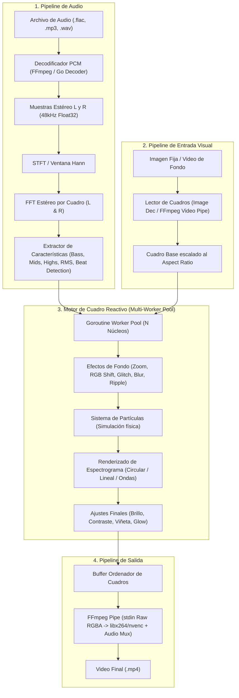

# Arquitectura del Sistema y Flujo de Procesamiento

## 1. Diagrama de Flujo del Pipeline



## 2. Decisión Arquitectónica: Zero-CGO vs CGO (Bindings FFmpeg)

### Ventajas del Enfoque Pipe FFmpeg (Sin CGO):
1. **Compilación Limpia y Portabilidad Inmediata**:
   - `CGO_ENABLED=0 go build -o audio-bg main.go` genera un binario sin enlaces dinámicos rotos a `libavcodec.so` o versiones conflictivas.
   - Fácil de distribuir en cualquier Linux, macOS o Windows simplemente teniendo `ffmpeg` en el `$PATH`.
2. **Máxima Eficiencia y Uso de Aceleración por Hardware**:
   - La codificación H.264 / H.265 puede delegarse a NVENC (`h264_nvenc`), Intel QSV, Apple VideoToolbox o `libx264` estándar sin recompilar Go.
3. **Flujo de Memoria en Streaming**:
   - Entrada: `ffmpeg -i video.mp4 -f rawvideo -pix_fmt rgba -` (cuando el fondo es video).
   - Salida: `ffmpeg -f rawvideo -pix_fmt rgba -s WxH -r FPS -i - -i audio.flac -c:v libx264 -pix_fmt yuv420p output.mp4`.

## 3. Paralelismo y Concurrencia en Go

Para renderizar videos a 60 FPS o 30 FPS en alta resolución (1080p, 4K):
- **Goroutine Worker Pool**:
  - Se genera un canal de trabajos indexados por número de cuadro: `Job{FrameIdx int, Time float64, AudioFeat AudioFeatures, BgFrame image.Image}`.
  - Se instancian `runtime.NumCPU()` goroutines trabajadoras.
  - Cada worker calcula los efectos de distorsión, dibuja partículas y traza el espectrograma sobre el buffer de píxeles asignado.
- **Ordered Frame Sequencer**:
  - Un despachador de escritura asegura que los cuadros terminados se escriban en `ffmpeg.Stdin` en el orden secuencial estricto `[0, 1, 2, ... N]` sin desordenar el flujo de video.
- **Buffer Pool (`sync.Pool`)**:
  - Reutilización intensiva de buffers `image.RGBA` de píxeles crudos para evitar sobrecargar el Garbage Collector (GC) de Go al procesar decenas de miles de cuadros.

## 4. Estructura de Paquetes en el Proyecto

```
/home/jg/audio_bg/
├── cmd/
│   └── audio-bg/
│       └── main.go                  # Punto de entrada CLI, parseo de flags
├── pkg/
│   ├── config/                      # Definición de estructuras y carga YAML/JSON
│   └── presets/                     # Presets predeterminados integrados (embed.FS)
├── internal/
│   ├── audio/                       # Decodificación de audio, buffers PCM
│   ├── fft/                         # STFT, Ventanas Hann, Log-Mel Bins, Suavizado
│   ├── beats/                       # Detección de golpes/transitorios (Spectral Flux)
│   ├── visualizer/                  # Motores de espectrograma (Circular, Lineal, Osciloscopio)
│   ├── effects/                     # Shaders/Filtros Go (RGB Shift, Ripple, Zoom, Glitch)
│   ├── particles/                   # Sistema de partículas físicas reactivas
│   ├── renderer/                    # Compositor 2D, trazado anti-aliased (gg / fogleman)
│   └── pipeline/                    # Orquestador del pipeline, workers y pipes FFmpeg
├── configs/                         # Archivos YAML de presets de ejemplo
├── planning/                        # Documentación y especificaciones
└── go.mod, go.sum
```
