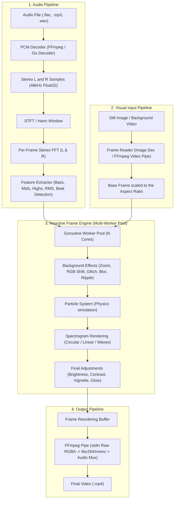

# System Architecture and Processing Flow

## 1. Pipeline Flow Diagram



## 2. Architectural Decision: Zero-CGO vs CGO (FFmpeg Bindings)

### Advantages of the FFmpeg Pipe Approach (No CGO):
1. **Clean Builds and Immediate Portability**:
   - `CGO_ENABLED=0 go build -o audio-bg main.go` produces a binary without broken dynamic links to `libavcodec.so` or conflicting versions.
   - Easy to distribute on any Linux, macOS or Windows simply by having `ffmpeg` in the `$PATH`.
2. **Maximum Efficiency and Use of Hardware Acceleration**:
   - H.264 / H.265 encoding can be delegated to NVENC (`h264_nvenc`), Intel QSV, Apple VideoToolbox or standard `libx264` without recompiling Go.
3. **Streaming Memory Flow**:
   - Input: `ffmpeg -i video.mp4 -f rawvideo -pix_fmt rgba -` (when the background is a video).
   - Output: `ffmpeg -f rawvideo -pix_fmt rgba -s WxH -r FPS -i - -i audio.flac -c:v libx264 -pix_fmt yuv420p output.mp4`.

## 3. Parallelism and Concurrency in Go

To render videos at 60 FPS or 30 FPS in high resolution (1080p, 4K):
- **Goroutine Worker Pool**:
  - A channel of jobs indexed by frame number is created: `Job{FrameIdx int, Time float64, AudioFeat AudioFeatures, BgFrame image.Image}`.
  - `runtime.NumCPU()` worker goroutines are spawned.
  - Each worker computes the distortion effects, draws particles and traces the spectrogram onto its assigned pixel buffer.
- **Ordered Frame Sequencer**:
  - A write dispatcher ensures finished frames are written to `ffmpeg.Stdin` in strict sequential order `[0, 1, 2, ... N]` without scrambling the video stream.
- **Buffer Pool (`sync.Pool`)**:
  - Heavy reuse of raw-pixel `image.RGBA` buffers to avoid overloading Go's Garbage Collector (GC) when processing tens of thousands of frames.

## 4. Project Package Structure

```
/home/jg/audio_bg/
├── cmd/
│   └── audio-bg/
│       └── main.go                  # CLI entry point, flag parsing
├── pkg/
│   ├── config/                      # Struct definitions and YAML/JSON loading
│   └── presets/                     # Built-in default presets (embed.FS)
├── internal/
│   ├── audio/                       # Audio decoding, PCM buffers
│   ├── fft/                         # STFT, Hann windows, Log-Mel bins, smoothing
│   ├── beats/                       # Beat/transient detection (Spectral Flux)
│   ├── visualizer/                  # Spectrogram engines (Circular, Linear, Oscilloscope)
│   ├── effects/                     # Go shaders/filters (RGB Shift, Ripple, Zoom, Glitch)
│   ├── particles/                   # Reactive physical particle system
│   ├── renderer/                    # 2D compositor, anti-aliased drawing (gg / fogleman)
│   └── pipeline/                    # Pipeline orchestrator, workers and FFmpeg pipes
├── configs/                         # Example preset YAML files
├── planning/                        # Documentation and specifications
└── go.mod, go.sum
```
