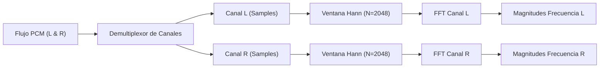

# Análisis de Audio y Extracción de Características Espectrales

## 1. Decodificación de Audio y Representación en Memoria

Para garantizar compatibilidad con cualquier formato (FLAC, MP3, WAV, OGG, AAC, AIFF), la pista se decodifica en un stream continuo de muestras PCM:
- **Tasa de Muestreo ($F_s$)**: 48,000 Hz o 44,100 Hz.
- **Canales**: 2 (Estéreo Estricto: Canal L = 0, Canal R = 1).
- **Formato de Muestra**: `float32` normalizado en el rango $[-1.0, 1.0]$.
- **Mapeo Temporal a Cuadros**:
  Para un video de $FPS$ cuadros por segundo (ej. 60 FPS), cada cuadro abarca:
  $$N_{\text{hop}} = \frac{F_s}{FPS} = \frac{48000}{60} = 800 \text{ muestras}$$

## 2. Short-Time Fourier Transform (STFT) y Separación Estéreo

Para cumplir con el requerimiento de simetría estéreo (*lado izquierdo representa canal L, lado derecho canal R*), el análisis espectral se realiza **independientemente** para cada canal:

### Parámetros del STFT:
- **Tamaño de Ventana ($N_{\text{fft}}$)**: 2048 muestras (~42.6 ms a 48kHz). Proporciona una resolución de frecuencia de $\Delta f = \frac{48000}{2048} \approx 23.4 \text{ Hz}$, ideal para discernir notas graves de sub-bass (30-100 Hz).
- **Función de Ventana**: Hann (Hanning) para mitigar el *spectral leakage*:
  $$w(n) = 0.5 \cdot \left(1 - \cos\left(\frac{2\pi n}{N-1}\right)\right)$$
- **FFT Algoritmo**: Radix-2 Cooley-Tukey optimizado en Go puro (ej. paquete nativo Go FFT o biblioteca especializada sin CGO).

## 3. Escalamiento de Frecuencias (Log / Mel Bins)

La percepción auditiva humana del tono es logarítmica, no lineal. Si mostramos 1024 bins lineales en pantalla, el 80% de las barras visuales estarían en agudos inaudibles o frecuencias ultra-altas casi vacías, mientras que los graves (kicks, 808s, bajos) quedarían amontonados en 2 o 3 barras.

### Algoritmo de Agrupación (Binning):
1. Definir rango audible de interés: $f_{\min} = 20 \text{ Hz}$, $f_{\max} = 18,000 \text{ Hz}$.
2. Para $B$ barras por canal (ej. $B = 48$ o $64$ barras):
   $$f_i = f_{\min} \cdot \left(\frac{f_{\max}}{f_{\min}}\right)^{\frac{i}{B}}$$
3. Para cada banda $i$, se promedian o toma el valor cuadrático medio (RMS) de los bins de la FFT correspondientes.

## 4. Suavizado Temporal y Balística (Attack & Decay)

El audio bruto puede generar saltos erráticos y parpadeos molestos entre cuadros consecutivos. Para lograr barras fluidas y cinematográficas:
- **Attack (Ataque Instantáneo)**: Cuando la nueva magnitud es mayor que el valor del cuadro anterior, sube rápidamente con un coeficiente alto ($\alpha_{\text{attack}} \approx 0.85$).
- **Decay (Caída Suave)**: Cuando la energía desciende, decae gradualmente ($\alpha_{\text{decay}} \approx 0.15$):
  $$V_t = \max(V_{\text{target}}, V_{t-1} \cdot (1 - \text{DecayRate}))$$
- **Peak Indicators (Opcional)**: Pequeñas tapas o líneas que flotan sobre las barras y caen por gravedad simulada.

## 5. Detección de Golpes y Transitorios (Beat & Bass Flux)

Para alimentar las distorsiones del fondo (zoom, shake, glitch, partículas):
- **Bass Energy Tracker**: Se calcula la energía integrada en el rango $20 - 150 \text{ Hz}$.
- **Spectral Flux**: Diferencia de energía positiva entre cuadros sucesivos:
  $$\text{Flux}_t = \sum_{k \in \text{Bass}} \max(0, |X_t(k)| - |X_{t-1}(k)|)$$
- **Umbral Adaptativo (Adaptive Threshold)**:
  Un golpe (*kick/beat*) se dispara cuando $\text{Flux}_t > \mu_{\text{history}} \cdot \lambda$, activando eventos de:
  - Pulso de escala de la imagen ($1.0 \rightarrow 1.08 \rightarrow 1.0$).
  - Separación cromática RGB temporal.
  - Emisión de ráfaga de partículas.
