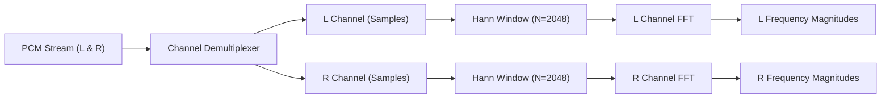

# Audio Analysis and Spectral Feature Extraction

## 1. Audio Decoding and In-Memory Representation

To guarantee compatibility with any format (FLAC, MP3, WAV, OGG, AAC, AIFF), the track is decoded into a continuous stream of PCM samples:
- **Sample Rate ($F_s$)**: 48,000 Hz or 44,100 Hz.
- **Channels**: 2 (Strict Stereo: L Channel = 0, R Channel = 1).
- **Sample Format**: `float32` normalized to the range $[-1.0, 1.0]$.
- **Time-to-Frame Mapping**:
  For a video at $FPS$ frames per second (e.g. 60 FPS), each frame covers:
  $$N_{\text{hop}} = \frac{F_s}{FPS} = \frac{48000}{60} = 800 \text{ samples}$$

## 2. Short-Time Fourier Transform (STFT) and Stereo Separation

To meet the stereo symmetry requirement (*left side represents the L channel, right side the R channel*), the spectral analysis is performed **independently** for each channel:

### STFT Parameters:
- **Window Size ($N_{\text{fft}}$)**: 2048 samples (~42.6 ms at 48kHz). Gives a frequency resolution of $\Delta f = \frac{48000}{2048} \approx 23.4 \text{ Hz}$, ideal for distinguishing low sub-bass notes (30-100 Hz).
- **Window Function**: Hann (Hanning) to mitigate *spectral leakage*:
  $$w(n) = 0.5 \cdot \left(1 - \cos\left(\frac{2\pi n}{N-1}\right)\right)$$
- **FFT Algorithm**: Radix-2 Cooley-Tukey optimized in pure Go (e.g. a native Go FFT package or a specialized library without CGO).

## 3. Frequency Scaling (Log / Mel Bins)

Human pitch perception is logarithmic, not linear. If we showed 1024 linear bins on screen, 80% of the visual bars would sit in inaudible treble or nearly empty ultra-high frequencies, while the bass (kicks, 808s, bass lines) would be crammed into 2 or 3 bars.

### Grouping Algorithm (Binning):
1. Define the audible range of interest: $f_{\min} = 20 \text{ Hz}$, $f_{\max} = 18,000 \text{ Hz}$.
2. For $B$ bars per channel (e.g. $B = 48$ or $64$ bars):
   $$f_i = f_{\min} \cdot \left(\frac{f_{\max}}{f_{\min}}\right)^{\frac{i}{B}}$$
3. For each band $i$, the corresponding FFT bins are averaged or their root mean square (RMS) is taken.

## 4. Temporal Smoothing and Ballistics (Attack & Decay)

Raw audio can produce erratic jumps and annoying flicker between consecutive frames. To get smooth, cinematic bars:
- **Attack (Instant Attack)**: When the new magnitude is greater than the previous frame's value, it rises quickly with a high coefficient ($\alpha_{\text{attack}} \approx 0.85$).
- **Decay (Smooth Fall)**: When the energy drops, it decays gradually ($\alpha_{\text{decay}} \approx 0.15$):
  $$V_t = \max(V_{\text{target}}, V_{t-1} \cdot (1 - \text{DecayRate}))$$
- **Peak Indicators (Optional)**: Small caps or lines that float above the bars and fall under simulated gravity.

## 5. Beat and Transient Detection (Beat & Bass Flux)

To feed the background distortions (zoom, shake, glitch, particles):
- **Bass Energy Tracker**: The integrated energy in the $20 - 150 \text{ Hz}$ range is computed.
- **Spectral Flux**: Positive energy difference between successive frames:
  $$\text{Flux}_t = \sum_{k \in \text{Bass}} \max(0, |X_t(k)| - |X_{t-1}(k)|)$$
- **Adaptive Threshold**:
  A hit (*kick/beat*) fires when $\text{Flux}_t > \mu_{\text{history}} \cdot \lambda$, triggering events such as:
  - Image scale pulse ($1.0 \rightarrow 1.08 \rightarrow 1.0$).
  - Temporary RGB chromatic separation.
  - Particle burst emission.
