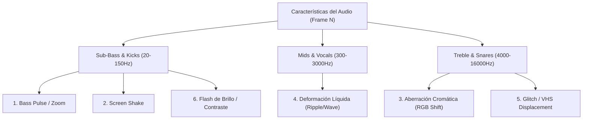

# Efectos Visuales y Tratamiento del Fondo (Imagen y Video)

## 1. Modos de Fondo Admitidos

### A. Imagen Estática (PNG, JPG, WebP)
- **Modos de Ajuste (Aspect Ratio Fit)**:
  - `Cover`: Escala la imagen para llenar la resolución destino (ej. 1920x1080 o 1080x1920 para formato vertical), recortando excesos sin bandas negras.
  - `Contain`: Ajusta la imagen dentro de los límites manteniendo su proporción completa.
  - `Blur Padding`: La imagen original se muestra centrada y las barras laterales/superiores se rellenan con una versión ampliada y desenfocada (*Gaussian Blur*) de la misma imagen.
- **Preparación de Buffer**: La imagen se pre-renderiza en memoria una sola vez en la resolución objetivo con formato RGBA rápido.

### B. Video de Fondo (MP4, MKV, MOV, WebM)
- **Decodificación en Streaming Continuo**:
  Un pipe de lectura conectado a FFmpeg extrae los cuadros secuenciales a la velocidad de fotogramas del video resultante.
- **Looping Inteligente**:
  Si el audio dura más que el video (ej. audio de 4:30 min y video de 30 segundos), el lector de video reinicia el flujo automáticamente sin cortes perceptibles o con una transición suave.

---

## 2. Efectos de Distorsión Reactivos al Audio

Cada efecto está parametrizado con intensidades mínimas y multiplicadores según las frecuencias de audio:

### 1. Bass Pulse / Zoom Dinámico
- Al detectar un aumento de energía en graves ($E_{\text{bass}}$), el fondo se amplía desde el centro mediante interpolación bilineal:
  $$\text{Scale} = 1.0 + (\text{MaxZoom} - 1.0) \cdot E_{\text{bass}}^{\gamma}$$
- Se aplica amortiguación elástica de retorno para que el efecto "respire" como un diafragma de altavoz.

### 2. Aberración Cromática (Separación de Canales RGB)
- Desplaza las coordenadas de lectura de los canales Rojo ($R$) y Azul ($B$) respecto al Verde ($G$):
  - $R(x, y) = \text{Image}(x + \delta_x, y + \delta_y).R$
  - $G(x, y) = \text{Image}(x, y).G$
  - $B(x, y) = \text{Image}(x - \delta_x, y - \delta_y).B$
- $\delta_x, \delta_y$ pueden ser radiales (desde el centro) o direccionales horizontales, modulados por la intensidad del transitorio.

### 3. Deformación Líquida y Ondas (Ripple / Sine Displacement)
- Aplica una función de desplazamiento senoidal a las coordenadas de píxeles:
  $$x' = x + A \cdot \sin(k_y \cdot y + \omega t) \cdot E_{\text{mids}}$$
  $$y' = y + A \cdot \cos(k_x \cdot x + \omega t) \cdot E_{\text{mids}}$$
- Produce un efecto de ondulación acuática o distorsión psicodélica durante pasajes instrumentales.

### 4. Glitch y Desplazamiento VHS
- Activado opcionalmente cuando el *Spectral Flux* supera un umbral crítico (drops, golpes de platillos o cajas fuertes):
  - Desplazamiento horizontal aleatorio de franjas de scanlines ($\text{Scanline Jitter}$).
  - Inversión selectiva o ruido estático en bloques rectangulares.
  - Tiempo de decaimiento ultracorto (1 a 3 cuadros) para dar sensación de fallo eléctrico instantáneo.

### 5. Ajustes de Iluminación y Color Reactivo
- **Brillo & Contraste**: El contraste se acentúa en momentos de calma y el brillo estalla en los picos de percusión.
- **Tinte / Color Grading**:
  - Matriz de tinte reactiva o viñeta oscura en los bordes para resaltar el visualizador central.
  - Opacidad configurable del fondo para no competir visualmente con el espectrograma.
