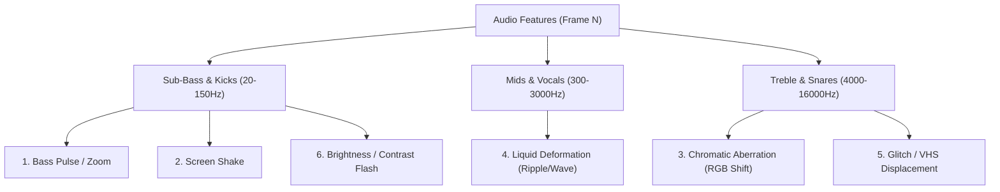

# Visual Effects and Background Handling (Image and Video)

## 1. Supported Background Modes

### A. Static Image (PNG, JPG, WebP)
- **Fit Modes (Aspect Ratio Fit)**:
  - `Cover`: Scales the image to fill the target resolution (e.g. 1920x1080, or 1080x1920 for vertical format), cropping the excess with no black bars.
  - `Contain`: Fits the image within the bounds while keeping its full proportions.
  - `Blur Padding`: The original image is shown centered and the side/top bars are filled with an enlarged, blurred (*Gaussian Blur*) version of the same image.
- **Buffer Preparation**: The image is pre-rendered in memory only once at the target resolution in a fast RGBA format.

### B. Background Video (MP4, MKV, MOV, WebM)
- **Continuous Streaming Decoding**:
  A read pipe connected to FFmpeg extracts sequential frames at the output video's frame rate.
- **Smart Looping**:
  If the audio is longer than the video (e.g. 4:30 min of audio and a 30-second video), the video reader restarts the stream automatically with no noticeable cuts, or with a smooth transition.

---

## 2. Audio-Reactive Distortion Effects

Each effect is parameterized with minimum intensities and multipliers based on the audio frequencies:

### 1. Dynamic Bass Pulse / Zoom
- When an increase in bass energy ($E_{\text{bass}}$) is detected, the background is enlarged from the center using bilinear interpolation:
  $$\text{Scale} = 1.0 + (\text{MaxZoom} - 1.0) \cdot E_{\text{bass}}^{\gamma}$$
- Elastic return damping is applied so the effect "breathes" like a speaker diaphragm.

### 2. Chromatic Aberration (RGB Channel Separation)
- Shifts the read coordinates of the Red ($R$) and Blue ($B$) channels relative to Green ($G$):
  - $R(x, y) = \text{Image}(x + \delta_x, y + \delta_y).R$
  - $G(x, y) = \text{Image}(x, y).G$
  - $B(x, y) = \text{Image}(x - \delta_x, y - \delta_y).B$
- $\delta_x, \delta_y$ can be radial (from the center) or horizontal-directional, modulated by the transient's intensity.

### 3. Liquid Deformation and Waves (Ripple / Sine Displacement)
- Applies a sinusoidal displacement function to the pixel coordinates:
  $$x' = x + A \cdot \sin(k_y \cdot y + \omega t) \cdot E_{\text{mids}}$$
  $$y' = y + A \cdot \cos(k_x \cdot x + \omega t) \cdot E_{\text{mids}}$$
- Produces a watery ripple effect or psychedelic distortion during instrumental passages.

### 4. Glitch and VHS Displacement
- Optionally triggered when the *Spectral Flux* exceeds a critical threshold (drops, cymbal hits or loud snares):
  - Random horizontal displacement of scanline stripes ($\text{Scanline Jitter}$).
  - Selective inversion or static noise in rectangular blocks.
  - Ultra-short decay time (1 to 3 frames) to give the feel of an instant electrical fault.

### 5. Reactive Lighting and Color Adjustments
- **Brightness & Contrast**: Contrast is accentuated in calm moments and brightness bursts on percussion peaks.
- **Tint / Color Grading**:
  - Reactive tint matrix or dark vignette at the edges to highlight the central visualizer.
  - Configurable background opacity so it doesn't compete visually with the spectrogram.
