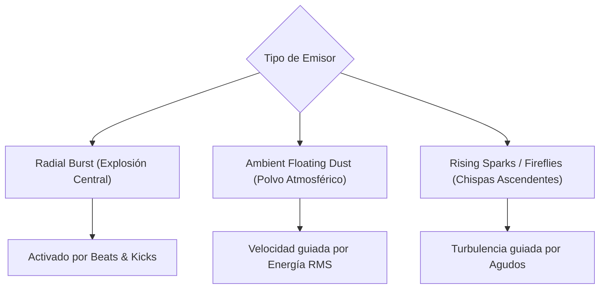

# Sistema de Partículas Reactivo (Opcional)

## 1. Concepto y Objetivos del Módulo

El sistema de partículas aporta dinamismo tridimensional y profundidad visual sin recargar el fondo:
- Es totalmente opcional y conmutable mediante configuración (`particles.enabled: true/false`).
- Integra un motor de física 2D ligero en Go (posición, velocidad, aceleración, fricción, tiempo de vida y desvanecimiento alfa).
- Reacciona dinámicamente tanto a la energía constante de la pista como a los golpes de percusión puntuales.

---

## 2. Tipos de Emisores de Partículas

### A. Radial Burst (Explosión Central)
- **Origen**: Centro del cuadro o centro del visualizador circular.
- **Comportamiento**:
  - En reposo: Emite una cantidad moderada de partículas lentas.
  - En un pico de graves (*Bass Kick / Drop*): Dispara una ráfaga radial de 50 a 200 partículas a gran velocidad hacia los extremos de la pantalla.
- **Efecto Visual**: Sensación de onda expansiva o supernova sincronizada con la batería.

### B. Ambient Floating Dust (Polvo Atmosférico / Bokeh)
- **Origen**: Dispersas por todo el lienzo.
- **Comportamiento**:
  - Movimiento browniano suave con turbulencia armónica basada en ruido Simplex/Perlin.
  - El tamaño y el brillo de cada mota de polvo palpitan sutilmente con la amplitud general de la música.
- **Efecto Visual**: Crea una atmósfera cinematográfica envolvente, similar a partículas de luz en el aire.

### C. Rising Sparks (Chispas Ascendentes)
- **Origen**: Borde inferior de la pantalla.
- **Comportamiento**:
  - Ascienden con aceleración negativa (gravedad inversa) y oscilación senoidal horizontal.
  - La cantidad de chispas aumenta exponencialmente en los estribillos o pasajes de alta energía.

---

## 3. Modelo Matemático y Reactividad al Audio

Cada partícula $p$ en el instante $t$ se actualiza según:

$$\vec{v}_t = (\vec{v}_{t-1} + \vec{a} \cdot \Delta t) \cdot (1 - \text{drag})$$
$$\vec{x}_t = \vec{x}_{t-1} + \vec{v}_t \cdot (1.0 + k_{\text{audio}} \cdot E_{\text{bass}})$$
$$\text{Life}_t = \text{Life}_{t-1} - \Delta t$$
$$\alpha_t = \alpha_{\max} \cdot \left(\frac{\text{Life}_t}{\text{Life}_{\text{total}}}\right)^{\gamma}$$

### Renderizado de Partículas:
- Trazado como círculos con degradado radial suave (*soft glow*).
- Opcionalmente con estela de movimiento (*motion blur tail*) conectando $\vec{x}_{t-1}$ con $\vec{x}_t$.
- Modo de mezcla aditiva (*Additive Blending*): cuando varias partículas se superponen, sus colores se suman generando destellos luminosos intensos.
