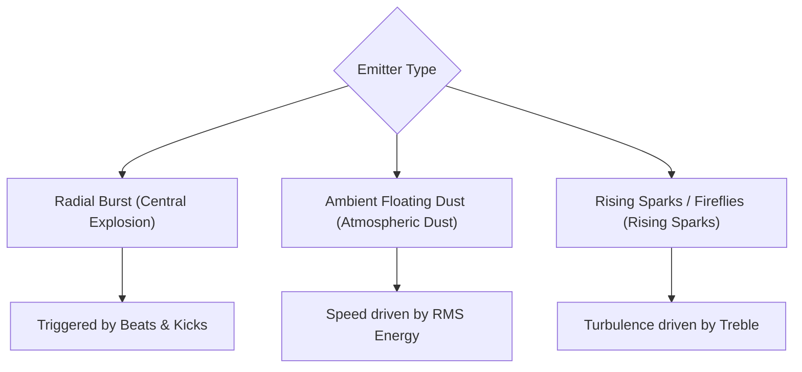

# Reactive Particle System (Optional)

## 1. Module Concept and Goals

The particle system adds three-dimensional dynamism and visual depth without cluttering the background:
- It is fully optional and can be toggled via configuration (`particles.enabled: true/false`).
- It integrates a lightweight 2D physics engine in Go (position, velocity, acceleration, friction, lifetime and alpha fade-out).
- It reacts dynamically both to the track's sustained energy and to individual percussion hits.

---

## 2. Particle Emitter Types

### A. Radial Burst (Central Explosion)
- **Origin**: Center of the frame or center of the circular visualizer.
- **Behavior**:
  - At rest: Emits a moderate number of slow particles.
  - On a bass peak (*Bass Kick / Drop*): Fires a radial burst of 50 to 200 particles at high speed towards the edges of the screen.
- **Visual Effect**: A shockwave or supernova feel synchronized with the drums.

### B. Ambient Floating Dust (Atmospheric Dust / Bokeh)
- **Origin**: Scattered across the whole canvas.
- **Behavior**:
  - Smooth Brownian motion with harmonic turbulence based on Simplex/Perlin noise.
  - The size and brightness of each dust speck pulse subtly with the overall amplitude of the music.
- **Visual Effect**: Creates an immersive cinematic atmosphere, similar to specks of light in the air.

### C. Rising Sparks
- **Origin**: Bottom edge of the screen.
- **Behavior**:
  - They rise with negative acceleration (inverse gravity) and horizontal sinusoidal oscillation.
  - The number of sparks increases exponentially in choruses or high-energy passages.

---

## 3. Mathematical Model and Audio Reactivity

Each particle $p$ at time $t$ is updated as follows:

$$\vec{v}_t = (\vec{v}_{t-1} + \vec{a} \cdot \Delta t) \cdot (1 - \text{drag})$$
$$\vec{x}_t = \vec{x}_{t-1} + \vec{v}_t \cdot (1.0 + k_{\text{audio}} \cdot E_{\text{bass}})$$
$$\text{Life}_t = \text{Life}_{t-1} - \Delta t$$
$$\alpha_t = \alpha_{\max} \cdot \left(\frac{\text{Life}_t}{\text{Life}_{\text{total}}}\right)^{\gamma}$$

### Particle Rendering:
- Drawn as circles with a smooth radial gradient (*soft glow*).
- Optionally with a motion trail (*motion blur tail*) connecting $\vec{x}_{t-1}$ to $\vec{x}_t$.
- Additive blend mode (*Additive Blending*): when several particles overlap, their colors add up, producing intense bright flashes.
